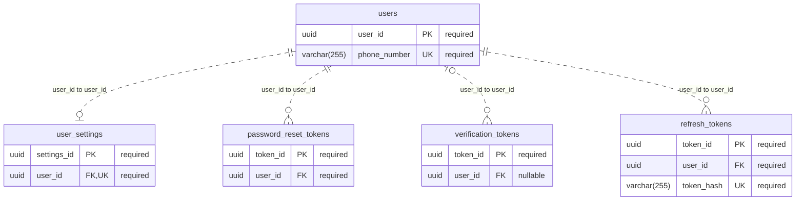
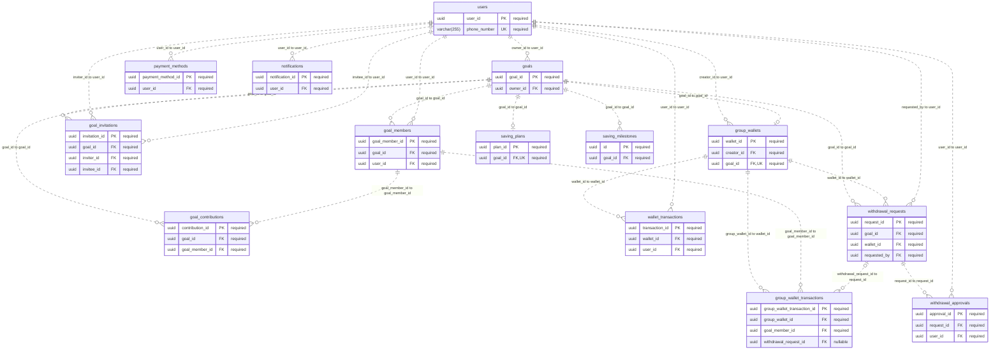
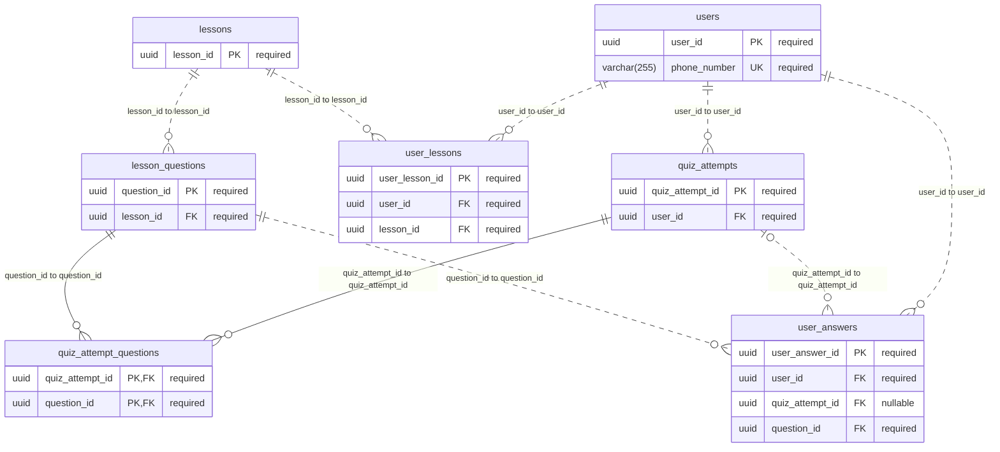
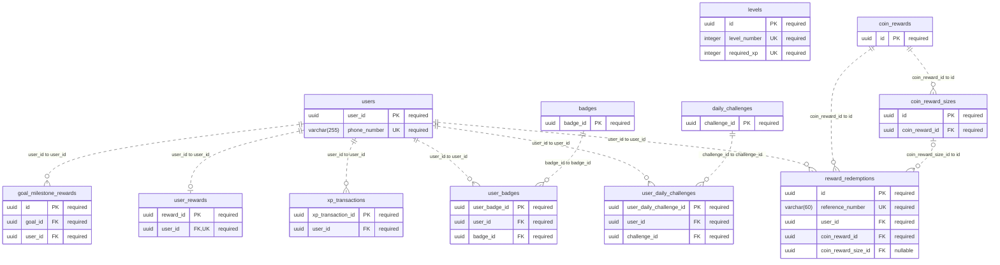
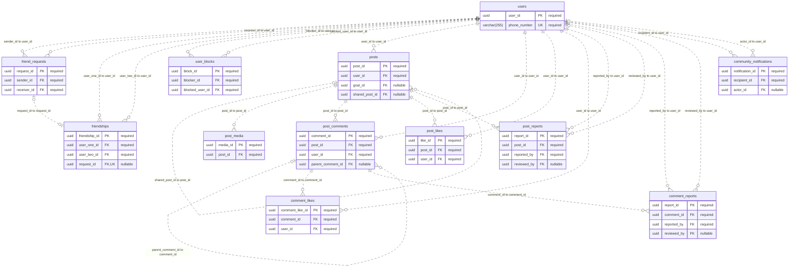
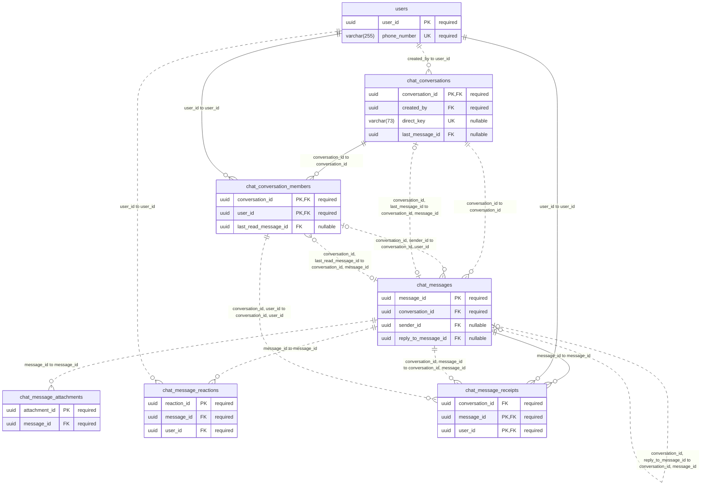
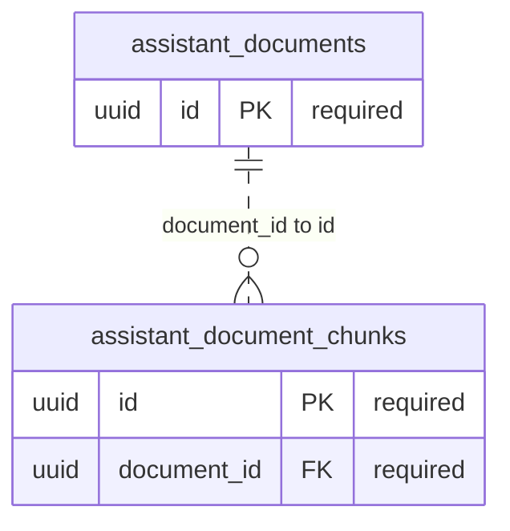

# NextGoal database schema and explanation

Updated **30 September 2026** against the current backend source and Flyway migrations (backend base commit `3c3bce9`).

NextGoal uses **52 core PostgreSQL tables**, plus **2 document-retrieval tables** installed by the optional `rag` migration location: **54 application tables and 461 columns** in total. Redis handles short-lived OTP and response-cache data. Uploaded community/chat media lives in object storage; SQL stores its metadata and object paths.

The [complete Mermaid ERD](nextgoal_erd.mermaid) and this explanation describe the same schema. Smaller domain diagrams are included below the table dictionary. This is a source-verified design document, not an inspection of the deployed database.

## What this version corrects

| Older description | Current implementation |
| --- | --- |
| `users.id` and email-based account fields | The key is `users.user_id`; phone number is the login identity. V10 removed email. |
| Separate `saving_goals`, `saving_groups`, group members and personal wallets | `goals`, `goal_members`, `goal_invitations` and `group_wallets` cover savings. No separate group entity exists. |
| A goal type that selects personal versus shared | The current `GoalType` is `FLEXIBLE`. Participants are represented through membership. |
| `saving_contributions.user_id` | The table is `goal_contributions`; the contributor is reached through `goal_member_id`. |
| Two currency balances on a wallet | `group_wallets` has one `balance` and one `currency`. |
| Approval immediately withdraws money | `withdrawal_requests` and `withdrawal_approvals` track approval; the requester confirms before the debit is completed. |
| `user_follows` | Friend relationships use `friend_requests`, `friendships` and `user_blocks`. |
| One image URL on a post | Ordered images/videos are in `post_media`, including the `storage_path` added in V12. |
| A stored viewer-liked flag | Viewer-liked state is derived from `post_likes`. Comments and replies are in `post_comments`. |
| `user_rewards` as a catalog or redemption junction | It is a per-user XP/level/streak summary. The catalog and orders are `coin_rewards`, `coin_reward_sizes` and `reward_redemptions`. |
| One daily challenge row per user/day | The unique key is `(user_id, challenge_id, challenge_date)`, allowing multiple challenges per day. |
| A direct quiz-to-lesson relationship | `quiz_attempt_questions` selects questions for an attempt; each question belongs to a lesson. |
| SQL AI chat history or an SQL AI cache | `assistant_documents` and `assistant_document_chunks` store retrieval knowledge. Replies are cached in Redis; no server SQL `ai_chat_messages` table exists. |
| Bills, bill splits, transactions for QR codes | No corresponding application tables exist in these migrations. Retained settings or activity enum values do not establish such tables. |

## Reading the diagram correctly

The ERD uses physical table and column names. `PK` is a primary key, `FK` participates in a declared SQL foreign key, and `UK` marks a single-column unique key. Multiple PK fields form one composite primary key. Multi-column and partial unique constraints are listed in the dictionary rather than marking each column individually unique.

For each relationship, the label lists the child FK column(s), followed by the parent key column(s). `||` means exactly one, `o|` means zero or one, and `o{` means zero or many. A nullable FK permits no referenced parent. A solid line means all FK columns participate in the child's primary key; other relationships use a dotted line. Cardinality reflects database constraints, which can be less restrictive than application rules.

For example, `group_wallets.goal_id` is required and unique: a wallet must reference one goal, while the database allows a goal to have zero or one wallet. The goal-creation service normally creates a wallet and owner membership together. A unique FK does not require every parent to have a child.

## How the features use the tables

### Accounts and sign-in

`users` holds identity, encoded credentials, role, energy, XP and coin balance. `user_settings` holds preferences. OTP challenges are short-lived Redis records; successful verification can produce a row in `verification_tokens`. Password-reset and refresh credentials have separate hashed-token tables with expiry and consumption/revocation fields. `refresh_tokens.replaced_by_token_id` is a logical rotation reference without a database FK.

### Savings and withdrawals

Creating a goal writes `goals`, its `group_wallets` row and the owner's `goal_members` row. It can also create a `saving_plans` row when schedule fields are supplied. Invitations add participation through `goal_invitations` and membership; there is no second group table to join.

A deposit's contributor is identified through `goal_contributions.goal_member_id`. Goal progress and wallet balance are aggregates; contribution/transaction rows preserve history. Both `wallet_transactions` and `group_wallet_transactions` exist: the latter adds membership, currency, before/after balances and an optional withdrawal-request link. They should not be collapsed into a single table in the design document.

The withdrawal service creates a request and a PENDING approval row for each other active member. If there are no other active members, the request starts APPROVED. Otherwise, it requires approval from the other current active members; a rejection marks the request REJECTED. The requester can cancel a pending or approved request. Only requester confirmation of an APPROVED request debits the balances, records transaction history and marks the request COMPLETED. Approval counts and `canConfirm`/`canApprove` response flags are calculated, not stored columns. See [WithdrawalRequestServiceImpl](src/main/java/com/example/genz/transaction/service/WithdrawalRequestServiceImpl.java).

### Lessons, challenges and rewards

`lessons` has multiple `lesson_questions`. `user_lessons` records lesson progress. A `quiz_attempts` row has selected questions through `quiz_attempt_questions`, with submitted responses in `user_answers`. The join table is needed because a quiz is modeled as a set of questions, not a direct FK to one lesson.

`daily_challenges` defines rules, targets and rewards; `user_daily_challenges` records dated progress and awarded XP/coins. `badges` defines achievements and `user_badges` records unlocks. `xp_transactions` is an XP history, while both `users.total_xp` and `user_rewards.total_xp` store aggregates. The database does not synchronize those fields automatically.

`saving_milestones` describes goal checkpoints. `goal_milestone_rewards` records actual coin awards and uses partial unique indexes to prevent repeat awards at the same milestone. `users.coin_balance` is reward currency, separate from wallet money. `coin_rewards` and `coin_reward_sizes` define redeemable inventory; `reward_redemptions` preserves the selected item/size, charged coins and delivery details.

`levels` supplies XP thresholds for profile level calculation. `user_rewards.level` is a stored integer without an FK to that table, and its entity helper still uses a separate 500-XP formula. This document shows both as they exist; it does not assert they are one database-enforced value. See [LevelServiceImpl](src/main/java/com/example/genz/level/service/LevelServiceImpl.java) and [UserReward](src/main/java/com/example/genz/reward/entity/UserReward.java).

### Community posts and friendships

`friend_requests` records the invitation and response. `friendships` stores the accepted relationship as one ordered pair of user IDs. `user_blocks` records directional blocks. The pending-request unique index compares the unordered pair, so two opposite-direction PENDING requests cannot coexist.

`posts` stores authorship, text, audience and counters; optional `goal_id` links to savings. An in-app repost can use `shared_post_id` to reference the original post. Sharing text/a link to another mobile app or copying it to the clipboard does not itself create a new database post. Post media is a separate ordered collection in `post_media`.

Comments and replies are rows in `post_comments`; a reply has `parent_comment_id`. `post_likes` and `comment_likes` identify who liked the content. Stored counters support display but do not contain the underlying comments or likes, and they are maintained by application code rather than database triggers in these migrations. Reports have separate `post_reports` and `comment_reports` tables. Community notifications use actor/recipient fields and a JSON payload, separately from general `notifications`.

### Direct and group chat

`chat_conversations` holds conversation metadata; `chat_conversation_members` has the composite key `(conversation_id, user_id)` and per-member inbox/read state. `chat_messages` holds content. A composite sender FK points to membership, allowing a null sender only for SYSTEM messages. Attachments, emoji reactions and delivery/read receipts are separate tables because each message can have several of each.

Replies, the last-message pointer and members' last-read pointers use composite FKs to ensure the referenced message belongs to the same conversation. Last-message and last-read FKs are deferred until transaction end. `chat_message_receipts` uses `(message_id, user_id)` as its PK and verifies both conversation/message and conversation/membership. These are human messaging tables, not AI chat history.

### AI documents, media storage and caches

The optional RAG feature uses `assistant_documents` for document metadata and `assistant_document_chunks` for extracted text plus `vector(1536)` embeddings. `assistant_documents.owner_id` is a VARCHAR containing the authenticated principal name (currently the phone number); it is not a `users.user_id` FK. Retrieval filters by owner and embedding model. V24 labels existing vectors `text-embedding-3-small`, while current code explicitly writes `gemini-embedding-001` for new embeddings.

| Storage | Data | Relationship to this ERD |
| --- | --- | --- |
| PostgreSQL | Accounts, savings, learning, community, chat, reward history and optional document embeddings | The tables documented here. |
| Supabase object storage | Uploaded post/chat image, video and other attachment binaries | SQL stores URLs and `storage_path`; it does not store the binary files in these tables. |
| Redis | OTP challenges and expiring backend response/cache entries | No SQL entity or FK. AI reply cache defaults to 2 minutes; signed-media-URL cache defaults to 5 minutes. |
| Mobile local storage | Client AI conversation history and client caches | Not part of the backend PostgreSQL ERD. |

The RAG reply-cache key includes the owner, document revision, model and question. The shared cache falls back to the underlying operation when Redis is unavailable. The AI reply TTL is configurable; the signed-URL cache currently uses a five-minute constant. These are cache policies, not database constraints. See [RagService](src/main/java/com/example/genz/assistant/RagService.java), [RagStore](src/main/java/com/example/genz/assistant/RagStore.java) and [BackendResponseCache](src/main/java/com/example/genz/common/cache/BackendResponseCache.java).

## Table dictionary

The declarations below describe a **fresh database after the checked-in migrations**, including the optional RAG migrations. They preserve SQL types, precision, defaults, inline foreign keys and CHECK constraints. A primary key is implicitly NOT NULL, even when NOT NULL is not written separately. Other columns without NOT NULL are nullable; a DEFAULT does not make a column mandatory.

Composite keys and additional CHECK/FK constraints appear below each table. Index listings include explicit migration indexes, excluding the automatically created PK/UNIQUE indexes and duplicate index declarations that reuse a UNIQUE constraint name. These are reference snippets, not a replacement migration script.

### 1. Identity, authentication and preferences

#### `users`

The account and login identity. Other user-related tables normally reference `users.user_id`.

There is no `email` column: V10 removed it. V14 added `coin_balance`. UUID generation for this table is handled by the application; the SQL declaration does not supply a UUID default.

Initial definition: [B1__legacy_core_schema.sql](src/main/resources/db/migration/B1__legacy_core_schema.sql). Later migration changes are included below.

| Column | SQL declaration | Meaning |
| --- | --- | --- |
| `user_id` | `UUID PRIMARY KEY` | Unique identifier for this record. |
| `full_name` | `VARCHAR(255) NOT NULL` | Account display name. |
| `phone_number` | `VARCHAR(255) NOT NULL UNIQUE` | Unique phone number used for login and identity lookup. |
| `date_of_birth` | `DATE NOT NULL` | User birth date. |
| `gender` | `VARCHAR(255) NOT NULL` | Gender value stored by the application. |
| `password_hash` | `VARCHAR(255)` | Encoded password; nullable in the physical schema. |
| `pin_hash` | `VARCHAR(255)` | Encoded transaction/security PIN; nullable in the physical schema. |
| `status` | `VARCHAR(255) NOT NULL` | Account lifecycle status. |
| `role` | `VARCHAR(20) NOT NULL DEFAULT 'USER'` | Authorization role; the database permits USER or ADMIN. |
| `energy` | `INTEGER NOT NULL DEFAULT 100` | Current quiz energy balance. |
| `total_xp` | `INTEGER NOT NULL DEFAULT 0` | Accumulated user XP used by profile level calculation. |
| `energy_reset_date` | `DATE` | Date used to track the quiz energy reset. |
| `created_at` | `TIMESTAMP WITHOUT TIME ZONE` | Record creation timestamp. |
| `updated_at` | `TIMESTAMP WITHOUT TIME ZONE` | Last recorded update timestamp. |
| `coin_balance` | `INTEGER NOT NULL DEFAULT 0` | Spendable reward coin balance, separate from savings money. |

Additional table constraints:

```sql
CONSTRAINT ck_users_role CHECK (role IN ('USER', 'ADMIN'));
```

#### `user_settings`

At most one preferences row per user. Separating preferences avoids repeating them across feature tables.

These are persisted preferences, not proof that every notification channel or privacy toggle is implemented in every endpoint. `UNIQUE(user_id)` enforces at most one row, not that every account must already have one.

Initial definition: [B1__legacy_core_schema.sql](src/main/resources/db/migration/B1__legacy_core_schema.sql). Later migration changes are included below.

| Column | SQL declaration | Meaning |
| --- | --- | --- |
| `settings_id` | `UUID PRIMARY KEY` | Unique identifier for this record. |
| `user_id` | `UUID NOT NULL UNIQUE REFERENCES users(user_id)` | Related user account. |
| `language` | `VARCHAR(255) NOT NULL` | Preferred UI language. |
| `theme` | `VARCHAR(255) NOT NULL` | Preferred UI theme. |
| `bill_reminder` | `BOOLEAN NOT NULL` | Stored bill-reminder preference; it does not imply a bills table exists. |
| `avatar_url` | `VARCHAR(255)` | Profile image URL. |
| `goal_alert` | `BOOLEAN NOT NULL` | Preference for goal alerts. |
| `lesson_reminder` | `BOOLEAN NOT NULL` | Preference for lesson reminders. |
| `ai_tips` | `BOOLEAN NOT NULL` | Preference for AI tips. |
| `daily_challenge_enabled` | `BOOLEAN NOT NULL DEFAULT true` | Preference enabling daily challenges. |
| `face_id_enabled` | `BOOLEAN NOT NULL` | Stored biometric-login preference; no biometric template is stored here. |
| `auto_lock_minutes` | `INTEGER NOT NULL` | Preferred idle time before app locking. |
| `push_notifications_enabled` | `BOOLEAN NOT NULL` | Push-notification preference. |
| `sms_notifications_enabled` | `BOOLEAN NOT NULL` | SMS-notification preference. |
| `email_notifications_enabled` | `BOOLEAN NOT NULL` | Retained email-notification preference; users currently have no email column. |
| `profile_visibility` | `VARCHAR(255) NOT NULL` | Profile visibility preference. |
| `show_savings_goals_publicly` | `BOOLEAN NOT NULL` | Preference for showing savings goals publicly. |
| `show_full_name_on_posts` | `BOOLEAN NOT NULL` | Preference for displaying the full name on posts. |
| `allow_comments_on_posts` | `BOOLEAN NOT NULL` | Preference for allowing comments on the user's posts. |
| `preferred_currency` | `VARCHAR(255) NOT NULL` | Default display/selection currency; each goal wallet also has its own currency. |
| `created_at` | `TIMESTAMP WITHOUT TIME ZONE NOT NULL` | Record creation timestamp. |
| `updated_at` | `TIMESTAMP WITHOUT TIME ZONE` | Last recorded update timestamp. |

#### `password_reset_tokens`

One-time password-reset credentials associated with an existing user.

Initial definition: [V7__add_email_otp_flows.sql](src/main/resources/db/migration/V7__add_email_otp_flows.sql). Later migration changes are included below.

| Column | SQL declaration | Meaning |
| --- | --- | --- |
| `token_id` | `UUID PRIMARY KEY` | Unique identifier for this record. |
| `user_id` | `UUID NOT NULL REFERENCES users(user_id) ON DELETE CASCADE` | Related user account. |
| `token_hash` | `VARCHAR(255) NOT NULL` | Stored token hash, not the raw reset token. |
| `expires_at` | `TIMESTAMP WITHOUT TIME ZONE NOT NULL` | Expiration time. |
| `used` | `BOOLEAN NOT NULL DEFAULT FALSE` | Whether the one-time token has been consumed. |
| `created_at` | `TIMESTAMP WITHOUT TIME ZONE NOT NULL` | Record creation timestamp. |

Additional indexes:

```sql
CREATE INDEX ix_password_reset_tokens_hash ON password_reset_tokens (token_hash);
CREATE INDEX ix_password_reset_tokens_user ON password_reset_tokens (user_id);
```

#### `verification_tokens`

One-time verification credentials produced after OTP verification, with a purpose and phone number.

OTP challenges themselves live in Redis. V9 and V20 remove the legacy SQL `otps` table.

Initial definition: [V8__create_verification_tokens_table.sql](src/main/resources/db/migration/V8__create_verification_tokens_table.sql). Later migration changes are included below.

| Column | SQL declaration | Meaning |
| --- | --- | --- |
| `token_id` | `UUID PRIMARY KEY` | Unique identifier for this record. |
| `phone_number` | `VARCHAR(30) NOT NULL` | Phone number being verified. |
| `purpose` | `VARCHAR(30) NOT NULL DEFAULT 'REGISTRATION'` | Verification purpose; REGISTRATION is the database default. |
| `user_id` | `UUID REFERENCES users(user_id) ON DELETE CASCADE` | Optional existing user; registration can precede account creation. |
| `token_hash` | `VARCHAR(255) NOT NULL` | Stored verification-token hash. |
| `expires_at` | `TIMESTAMP WITHOUT TIME ZONE NOT NULL` | Expiration time. |
| `used` | `BOOLEAN NOT NULL DEFAULT FALSE` | Whether the verification token has been consumed. |
| `created_at` | `TIMESTAMP WITHOUT TIME ZONE NOT NULL` | Record creation timestamp. |

Additional indexes:

```sql
CREATE INDEX ix_verification_tokens_hash ON verification_tokens (token_hash);
CREATE INDEX ix_verification_tokens_phone ON verification_tokens (phone_number);
CREATE INDEX ix_verification_tokens_phone_purpose ON verification_tokens (phone_number, purpose);
CREATE INDEX ix_verification_tokens_user ON verification_tokens (user_id);
```

#### `refresh_tokens`

Refresh-token sessions, including revocation and rotation metadata.

Initial definition: [V11__create_refresh_tokens_table.sql](src/main/resources/db/migration/V11__create_refresh_tokens_table.sql). Later migration changes are included below.

| Column | SQL declaration | Meaning |
| --- | --- | --- |
| `token_id` | `UUID PRIMARY KEY` | Unique identifier for this record. |
| `user_id` | `UUID NOT NULL REFERENCES users(user_id) ON DELETE CASCADE` | Related user account. |
| `token_hash` | `VARCHAR(255) NOT NULL` | Unique stored hash of the refresh token. |
| `expires_at` | `TIMESTAMP WITHOUT TIME ZONE NOT NULL` | Expiration time. |
| `revoked` | `BOOLEAN NOT NULL DEFAULT FALSE` | Whether this token is revoked. |
| `created_at` | `TIMESTAMP WITHOUT TIME ZONE NOT NULL` | Record creation timestamp. |
| `replaced_by_token_id` | `UUID` | Logical pointer to a replacement refresh-token UUID; no SQL foreign key is declared. |

Additional indexes:

```sql
CREATE UNIQUE INDEX ux_refresh_tokens_hash ON refresh_tokens (token_hash);
CREATE INDEX ix_refresh_tokens_user ON refresh_tokens (user_id);
```

### 2. Savings, membership and money movement

#### `goals`

The shared structure for all savings goals: target, progress, owner and lifecycle. Additional participants are represented by goal membership.

There is no `saving_groups` table or `group_id` column. `goal_type` does not distinguish personal versus shared goals. `remain_balance` is a remaining-to-target field, not a second wallet balance. Money precision differs between tables; the definitions below preserve the actual SQL precision.

Initial definition: [B1__legacy_core_schema.sql](src/main/resources/db/migration/B1__legacy_core_schema.sql). Later migration changes are included below.

| Column | SQL declaration | Meaning |
| --- | --- | --- |
| `goal_id` | `UUID PRIMARY KEY` | Unique identifier for this record. |
| `goal_name` | `VARCHAR(100) NOT NULL` | Goal title. |
| `target_amount` | `NUMERIC(19, 4) NOT NULL` | Amount the goal aims to save. |
| `current_amount` | `NUMERIC(19, 4) NOT NULL DEFAULT 0` | Current saved amount recorded for the goal. |
| `target_date` | `DATE NOT NULL` | Target completion date. |
| `category` | `VARCHAR(255) NOT NULL` | Goal category. |
| `image_url` | `VARCHAR(500)` | Optional cover image URL. |
| `remain_balance` | `NUMERIC(38, 2)` | Stored amount still needed to reach the target; mapped as remaining in Java. |
| `status` | `VARCHAR(255) NOT NULL` | Goal lifecycle state. |
| `goal_type` | `VARCHAR(50) NOT NULL DEFAULT 'FLEXIBLE'` | Goal policy/type; the current Java enum and creation service use FLEXIBLE. |
| `owner_id` | `UUID NOT NULL REFERENCES users(user_id)` | User who owns the goal. |
| `created_at` | `TIMESTAMP WITHOUT TIME ZONE NOT NULL` | Record creation timestamp. |
| `updated_at` | `TIMESTAMP WITHOUT TIME ZONE` | Last recorded update timestamp. |
| `completed_at` | `TIMESTAMP WITHOUT TIME ZONE` | Recorded goal completion time, when present. |

Additional indexes:

```sql
CREATE INDEX ix_goals_owner ON goals (owner_id);
```

#### `goal_members`

Membership joins users to goals and records each participant's role and status.

V21 enforces one row per `(goal_id, user_id)`. The creation service also creates the owner as a member. Contributions reference this membership so a contribution identifies both its user and goal context.

Initial definition: [B1__legacy_core_schema.sql](src/main/resources/db/migration/B1__legacy_core_schema.sql). Later migration changes are included below.

| Column | SQL declaration | Meaning |
| --- | --- | --- |
| `goal_member_id` | `UUID PRIMARY KEY` | Unique identifier for this record. |
| `goal_id` | `UUID NOT NULL REFERENCES goals(goal_id)` | Related savings goal. |
| `user_id` | `UUID NOT NULL REFERENCES users(user_id)` | Related user account. |
| `role` | `VARCHAR(255) NOT NULL` | Member role within the goal, such as OWNER or MEMBER. |
| `status` | `VARCHAR(255) NOT NULL` | Membership lifecycle status. |
| `joined_at` | `TIMESTAMP WITHOUT TIME ZONE` | Time the membership was created/joined. |

Additional indexes:

```sql
CREATE INDEX ix_goal_members_goal ON goal_members (goal_id);
CREATE INDEX ix_goal_members_user ON goal_members (user_id);
CREATE UNIQUE INDEX uk_goal_members_goal_user ON goal_members (goal_id, user_id);
```

#### `goal_invitations`

Invitations to participate in an existing savings goal.

This is separate from community `friend_requests`: accepting a goal invitation and becoming friends are different actions.

Initial definition: [B1__legacy_core_schema.sql](src/main/resources/db/migration/B1__legacy_core_schema.sql). Later migration changes are included below.

| Column | SQL declaration | Meaning |
| --- | --- | --- |
| `invitation_id` | `UUID PRIMARY KEY` | Unique identifier for this record. |
| `goal_id` | `UUID NOT NULL REFERENCES goals(goal_id)` | Related savings goal. |
| `inviter_id` | `UUID NOT NULL REFERENCES users(user_id)` | User sending the invitation. |
| `invitee_id` | `UUID NOT NULL REFERENCES users(user_id)` | User receiving the invitation. |
| `status` | `VARCHAR(255) NOT NULL` | Invitation lifecycle status. |
| `created_at` | `TIMESTAMP WITHOUT TIME ZONE NOT NULL` | Record creation timestamp. |
| `responded_at` | `TIMESTAMP WITHOUT TIME ZONE` | Time of a response, when present. |

Additional indexes:

```sql
CREATE INDEX ix_goal_invitations_invitee ON goal_invitations (invitee_id, status);
```

#### `group_wallets`

The wallet backing a savings goal, including personal goals despite the historical table name.

`goal_id` is required and unique, so each wallet belongs to one goal and each goal has at most one wallet. Goal creation normally creates it. There are no separate `wallets`, `balance_usd`, or `balance_khr` columns/tables in this schema.

Initial definition: [B1__legacy_core_schema.sql](src/main/resources/db/migration/B1__legacy_core_schema.sql). Later migration changes are included below.

| Column | SQL declaration | Meaning |
| --- | --- | --- |
| `wallet_id` | `UUID PRIMARY KEY` | Unique identifier for this record. |
| `balance` | `NUMERIC(19, 2) NOT NULL` | Wallet balance, stored at two decimal places. |
| `creator_id` | `UUID NOT NULL REFERENCES users(user_id)` | User recorded as wallet creator/owner. |
| `goal_id` | `UUID NOT NULL UNIQUE REFERENCES goals(goal_id)` | Related savings goal. |
| `created_at` | `TIMESTAMP WITHOUT TIME ZONE` | Record creation timestamp. |
| `updated_at` | `TIMESTAMP WITHOUT TIME ZONE` | Last recorded update timestamp. |
| `currency` | `VARCHAR(255) NOT NULL` | Currency in which this wallet balance is denominated. |

#### `saving_plans`

Optional contribution schedule for a goal, kept separately from its target and current balance.

One plan per goal at most, enforced by `UNIQUE(goal_id)`. The plan is deleted if its goal is physically deleted.

Initial definition: [V5__reconcile_goal_domain_schema.sql](src/main/resources/db/migration/V5__reconcile_goal_domain_schema.sql). Later migration changes are included below.

| Column | SQL declaration | Meaning |
| --- | --- | --- |
| `plan_id` | `UUID PRIMARY KEY` | Unique identifier for this record. |
| `goal_id` | `UUID NOT NULL UNIQUE REFERENCES goals(goal_id) ON DELETE CASCADE` | Related savings goal. |
| `contribution_amount` | `NUMERIC(19, 4) NOT NULL` | Planned amount per contribution period. |
| `frequency` | `VARCHAR(50) NOT NULL` | Contribution schedule frequency. |
| `next_contribution_date` | `DATE NOT NULL` | Next scheduled contribution date. |
| `status` | `VARCHAR(50) NOT NULL DEFAULT 'ACTIVE'` | Plan lifecycle status. |
| `contributed_this_period` | `NUMERIC(19, 4) NOT NULL DEFAULT 0` | Amount recorded against the current contribution period. |
| `created_at` | `TIMESTAMP WITHOUT TIME ZONE NOT NULL DEFAULT now()` | Record creation timestamp. |
| `updated_at` | `TIMESTAMP WITHOUT TIME ZONE` | Last recorded update timestamp. |

#### `goal_contributions`

Individual deposits toward goals. This history is distinct from the goal's current aggregate balance.

The contributor is found through `goal_contributions.goal_member_id -> goal_members.user_id`, not a direct `goal_contributions.user_id`. The two FKs do not by themselves guarantee that the referenced membership belongs to the same `goal_id`; the service must maintain that relationship.

Initial definition: [B1__legacy_core_schema.sql](src/main/resources/db/migration/B1__legacy_core_schema.sql). Later migration changes are included below.

| Column | SQL declaration | Meaning |
| --- | --- | --- |
| `contribution_id` | `UUID PRIMARY KEY` | Unique identifier for this record. |
| `goal_id` | `UUID NOT NULL REFERENCES goals(goal_id)` | Related savings goal. |
| `goal_member_id` | `UUID NOT NULL REFERENCES goal_members(goal_member_id)` | Membership identifying the contributor. |
| `amount` | `NUMERIC(19, 4) NOT NULL` | Contribution amount. |
| `note` | `VARCHAR(255)` | Optional contributor memo. |
| `contributed_at` | `TIMESTAMP WITHOUT TIME ZONE NOT NULL` | Time the contribution was recorded. |

#### `wallet_transactions`

Wallet transaction history associated directly with the acting user.

This table references `group_wallets.wallet_id`. It has no `payment_method_id` or `withdrawal_request_id` column. V22.1 removes stale enum CHECK constraints; current values are validated by the application.

Initial definition: [B1__legacy_core_schema.sql](src/main/resources/db/migration/B1__legacy_core_schema.sql). Later migration changes are included below.

| Column | SQL declaration | Meaning |
| --- | --- | --- |
| `transaction_id` | `UUID PRIMARY KEY` | Unique identifier for this record. |
| `wallet_id` | `UUID NOT NULL REFERENCES group_wallets(wallet_id)` | Goal wallet affected by the transaction. |
| `user_id` | `UUID NOT NULL REFERENCES users(user_id)` | Related user account. |
| `amount` | `NUMERIC(19, 2) NOT NULL` | Transaction amount, stored at two decimal places. |
| `transaction_type` | `VARCHAR(255) NOT NULL` | Application transaction type, including deposits and withdrawals. |
| `status` | `VARCHAR(255) NOT NULL` | Transaction result/status. |
| `description` | `VARCHAR(255) NOT NULL` | Human-readable transaction description. |
| `created_at` | `TIMESTAMP WITHOUT TIME ZONE NOT NULL` | Record creation timestamp. |

#### `group_wallet_transactions`

Member-level goal-wallet ledger with balance snapshots and an optional withdrawal-request reference.

Do not merge this table with `wallet_transactions` in the ERD: both exist and record different fields. Services maintain the consistency of wallet, goal and membership references.

Initial definition: [B1__legacy_core_schema.sql](src/main/resources/db/migration/B1__legacy_core_schema.sql). Later migration changes are included below.

| Column | SQL declaration | Meaning |
| --- | --- | --- |
| `group_wallet_transaction_id` | `UUID PRIMARY KEY` | Unique identifier for this record. |
| `group_wallet_id` | `UUID NOT NULL REFERENCES group_wallets(wallet_id)` | Goal wallet affected by this ledger entry. |
| `goal_member_id` | `UUID NOT NULL REFERENCES goal_members(goal_member_id)` | Membership responsible for the entry. |
| `withdrawal_request_id` | `UUID REFERENCES withdrawal_requests(request_id)` | Related withdrawal request, if this entry belongs to that workflow. |
| `transaction_type` | `VARCHAR(255) NOT NULL` | Member-ledger transaction type. |
| `amount` | `NUMERIC(19, 4) NOT NULL` | Ledger amount, stored at four decimal places. |
| `currency` | `VARCHAR(255) NOT NULL` | Currency recorded for this entry. |
| `balance_before` | `NUMERIC(19, 4) NOT NULL` | Wallet balance before the entry. |
| `balance_after` | `NUMERIC(19, 4) NOT NULL` | Wallet balance after the entry. |
| `status` | `VARCHAR(255) NOT NULL` | Member-ledger transaction status. |
| `created_at` | `TIMESTAMP WITHOUT TIME ZONE NOT NULL` | Record creation timestamp. |

#### `withdrawal_requests`

Requested withdrawals from a goal wallet, including the requester and approval/completion state.

Approval does not debit money. The requester must confirm an APPROVED request. Required/approved/pending counts and permission flags are calculated for the response; they are not columns in this table.

Initial definition: [B1__legacy_core_schema.sql](src/main/resources/db/migration/B1__legacy_core_schema.sql). Later migration changes are included below.

| Column | SQL declaration | Meaning |
| --- | --- | --- |
| `request_id` | `UUID PRIMARY KEY` | Unique identifier for this record. |
| `goal_id` | `UUID NOT NULL REFERENCES goals(goal_id)` | Related savings goal. |
| `wallet_id` | `UUID NOT NULL REFERENCES group_wallets(wallet_id)` | Related goal wallet. |
| `requested_by` | `UUID NOT NULL REFERENCES users(user_id)` | User requesting the withdrawal. |
| `amount` | `NUMERIC(19, 4) NOT NULL` | Requested withdrawal amount. |
| `reason` | `VARCHAR(500)` | Optional withdrawal explanation. |
| `status` | `VARCHAR(255) NOT NULL` | Application states: PENDING, APPROVED, REJECTED, CANCELLED or COMPLETED. |
| `created_at` | `TIMESTAMP WITHOUT TIME ZONE NOT NULL` | Record creation timestamp. |
| `resolved_at` | `TIMESTAMP WITHOUT TIME ZONE` | Time recorded when the request leaves pending or is subsequently completed/cancelled; not exclusively the payout time. |

#### `withdrawal_approvals`

One decision row per designated approver for a withdrawal request.

V22 enforces one approval per `(request_id, user_id)`. A non-null `decided_at` alone does not mean approval is complete; check `decision`.

Initial definition: [B1__legacy_core_schema.sql](src/main/resources/db/migration/B1__legacy_core_schema.sql). Later migration changes are included below.

| Column | SQL declaration | Meaning |
| --- | --- | --- |
| `approval_id` | `UUID PRIMARY KEY` | Unique identifier for this record. |
| `request_id` | `UUID NOT NULL REFERENCES withdrawal_requests(request_id)` | Withdrawal request being reviewed. |
| `user_id` | `UUID NOT NULL REFERENCES users(user_id)` | Designated approver. |
| `decision` | `VARCHAR(255) NOT NULL` | Application decision: PENDING, APPROVED or REJECTED. |
| `decided_at` | `TIMESTAMP WITHOUT TIME ZONE NOT NULL` | Required timestamp initialized when the pending approval is created, then updated when the user decides. |

Additional indexes:

```sql
CREATE UNIQUE INDEX uk_withdrawal_approvals_request_user ON withdrawal_approvals (request_id, user_id);
```

#### `payment_methods`

Saved payment-provider/account metadata belonging to a user.

There is no foreign key from either transaction table to this table. Do not claim that a transaction can be joined to its payment method from the current schema alone.

Initial definition: [B1__legacy_core_schema.sql](src/main/resources/db/migration/B1__legacy_core_schema.sql). Later migration changes are included below.

| Column | SQL declaration | Meaning |
| --- | --- | --- |
| `payment_method_id` | `UUID PRIMARY KEY` | Unique identifier for this record. |
| `user_id` | `UUID NOT NULL REFERENCES users(user_id)` | Related user account. |
| `method_type` | `VARCHAR(255) NOT NULL` | Payment method category. |
| `provider` | `VARCHAR(100) NOT NULL` | Provider name. |
| `account_name` | `VARCHAR(200) NOT NULL` | Name associated with the provider account. |
| `account_number_masked` | `VARCHAR(50) NOT NULL` | Masked account identifier for display. |
| `account_token` | `VARCHAR(500)` | Optional provider token/reference. |
| `currency` | `VARCHAR(255) NOT NULL` | Currency associated with the method. |
| `is_default` | `BOOLEAN` | Default-method preference; nullable in SQL and not uniquely enforced per user. |
| `status` | `VARCHAR(255) NOT NULL` | Payment method lifecycle/verification status. |
| `verified_at` | `TIMESTAMP WITHOUT TIME ZONE` | Recorded verification time. |
| `created_at` | `TIMESTAMP WITHOUT TIME ZONE NOT NULL` | Record creation timestamp. |
| `updated_at` | `TIMESTAMP WITHOUT TIME ZONE` | Last recorded update timestamp. |

#### `saving_milestones`

Progress checkpoints for a goal, separate from coin-award records.

`goal_milestone_rewards` records coins actually awarded; this table describes checkpoint progress. No unique `(goal_id, percentage)` constraint is declared by these migrations.

Initial definition: [B1__legacy_core_schema.sql](src/main/resources/db/migration/B1__legacy_core_schema.sql). Later migration changes are included below.

| Column | SQL declaration | Meaning |
| --- | --- | --- |
| `id` | `UUID PRIMARY KEY` | Unique identifier for this record. |
| `goal_id` | `UUID NOT NULL REFERENCES goals(goal_id)` | Related savings goal. |
| `percentage` | `NUMERIC(38, 2) NOT NULL` | Checkpoint percentage. |
| `amount_required` | `NUMERIC(19, 4) NOT NULL` | Saved amount required for the checkpoint. |
| `status` | `VARCHAR(255) NOT NULL` | Checkpoint progress state. |
| `reached_at` | `TIMESTAMP WITHOUT TIME ZONE` | Time the checkpoint was reached, when present. |
| `created_at` | `TIMESTAMP WITHOUT TIME ZONE` | Record creation timestamp. |

#### `notifications`

General application notifications, such as goal invitations and achievements.

This table is distinct from `community_notifications`, which has actor/recipient fields, JSON payload and `read_at`.

Initial definition: [V5__reconcile_goal_domain_schema.sql](src/main/resources/db/migration/V5__reconcile_goal_domain_schema.sql). Later migration changes are included below.

| Column | SQL declaration | Meaning |
| --- | --- | --- |
| `notification_id` | `UUID PRIMARY KEY` | Unique identifier for this record. |
| `user_id` | `UUID NOT NULL REFERENCES users(user_id) ON DELETE CASCADE` | Related user account. |
| `title` | `VARCHAR(255) NOT NULL` | Notification heading. |
| `message` | `VARCHAR(500) NOT NULL` | Notification text. |
| `type` | `VARCHAR(50) NOT NULL` | Application notification type. |
| `reference_id` | `UUID` | Optional feature-specific UUID; no SQL FK is declared. |
| `is_read` | `BOOLEAN NOT NULL DEFAULT false` | Read/unread flag. |
| `created_at` | `TIMESTAMP WITHOUT TIME ZONE NOT NULL DEFAULT now()` | Record creation timestamp. |

Additional indexes:

```sql
CREATE INDEX ix_notifications_user_created ON notifications (user_id, created_at DESC);
```

### 3. Learning and quizzes

#### `lessons`

Financial-learning content and lesson metadata.

Initial definition: [V3__create_quiz_attempt_questions_table.sql](src/main/resources/db/migration/V3__create_quiz_attempt_questions_table.sql). Later migration changes are included below.

| Column | SQL declaration | Meaning |
| --- | --- | --- |
| `lesson_id` | `UUID PRIMARY KEY` | Unique identifier for this record. |
| `title` | `VARCHAR(200) NOT NULL` | Lesson title. |
| `category` | `VARCHAR(50) NOT NULL` | Lesson category. |
| `content` | `TEXT` | Lesson text/content. |
| `difficulty` | `VARCHAR(50) NOT NULL` | Difficulty level. |
| `points_reward` | `INT` | Configured XP/points reward for the lesson. |
| `is_active` | `BOOLEAN` | Whether the lesson is enabled; nullable in the physical schema. |
| `created_at` | `TIMESTAMP WITHOUT TIME ZONE NOT NULL DEFAULT NOW()` | Record creation timestamp. |
| `updated_at` | `TIMESTAMP WITHOUT TIME ZONE` | Last recorded update timestamp. |

#### `lesson_questions`

Multiple-choice questions belonging to lessons.

Initial definition: [V3__create_quiz_attempt_questions_table.sql](src/main/resources/db/migration/V3__create_quiz_attempt_questions_table.sql). Later migration changes are included below.

| Column | SQL declaration | Meaning |
| --- | --- | --- |
| `question_id` | `UUID PRIMARY KEY` | Unique identifier for this record. |
| `lesson_id` | `UUID NOT NULL REFERENCES lessons(lesson_id) ON DELETE CASCADE` | Related lesson. |
| `question` | `TEXT NOT NULL` | Question text. |
| `option_a` | `VARCHAR(500) NOT NULL` | Answer option A. |
| `option_b` | `VARCHAR(500) NOT NULL` | Answer option B. |
| `option_c` | `VARCHAR(500) NOT NULL` | Answer option C. |
| `option_d` | `VARCHAR(500) NOT NULL` | Answer option D. |
| `correct_answer` | `VARCHAR(10) NOT NULL` | Correct answer choice. |
| `order_index` | `INT` | Question display order within the lesson. |

Additional indexes:

```sql
CREATE INDEX ix_lesson_questions_lesson_id ON lesson_questions (lesson_id);
```

#### `user_lessons`

User-specific lesson progress and completion information.

The migrations do not declare a unique `(user_id, lesson_id)` constraint. Do not label that pair as a database-enforced unique key.

Initial definition: [V3__create_quiz_attempt_questions_table.sql](src/main/resources/db/migration/V3__create_quiz_attempt_questions_table.sql). Later migration changes are included below.

| Column | SQL declaration | Meaning |
| --- | --- | --- |
| `user_lesson_id` | `UUID PRIMARY KEY` | Unique identifier for this record. |
| `user_id` | `UUID NOT NULL REFERENCES users(user_id) ON DELETE CASCADE` | Related user account. |
| `lesson_id` | `UUID NOT NULL REFERENCES lessons(lesson_id) ON DELETE CASCADE` | Related lesson. |
| `status` | `VARCHAR(50) NOT NULL` | Lesson progress state. |
| `score` | `INT` | Recorded lesson score. |
| `started_at` | `TIMESTAMP WITHOUT TIME ZONE` | Time the user started the lesson. |
| `completed_at` | `TIMESTAMP WITHOUT TIME ZONE` | Time the user completed the lesson. |

Additional indexes:

```sql
CREATE INDEX ix_user_lessons_user_id ON user_lessons (user_id);
```

#### `quiz_attempts`

A user's quiz session with aggregate score, XP and completion state.

There is no `lesson_id` or `question_id` column on `quiz_attempts`. Selected questions are stored in `quiz_attempt_questions`; responses are stored in `user_answers`.

Initial definition: [V3__create_quiz_attempt_questions_table.sql](src/main/resources/db/migration/V3__create_quiz_attempt_questions_table.sql). Later migration changes are included below.

| Column | SQL declaration | Meaning |
| --- | --- | --- |
| `quiz_attempt_id` | `UUID PRIMARY KEY` | Unique identifier for this record. |
| `user_id` | `UUID NOT NULL REFERENCES users(user_id) ON DELETE CASCADE` | Related user account. |
| `total_questions` | `INT NOT NULL DEFAULT 5` | Number of questions in the attempt; database default is 5. |
| `correct_answers` | `INT` | Number answered correctly. |
| `score` | `DOUBLE PRECISION` | Recorded quiz score as double precision. |
| `base_xp` | `INT NOT NULL DEFAULT 0` | Base XP for this attempt. |
| `bonus_xp` | `INT NOT NULL DEFAULT 0` | Bonus XP for this attempt. |
| `total_xp` | `INT NOT NULL DEFAULT 0` | Total XP for this attempt, not the user's lifetime XP. |
| `is_completed` | `BOOLEAN NOT NULL DEFAULT FALSE` | Whether the attempt has finished. |
| `started_at` | `TIMESTAMP WITHOUT TIME ZONE NOT NULL DEFAULT NOW()` | Attempt start time. |
| `completed_at` | `TIMESTAMP WITHOUT TIME ZONE` | Attempt completion time. |

Additional indexes:

```sql
CREATE INDEX ix_quiz_attempts_user_id ON quiz_attempts (user_id);
```

#### `quiz_attempt_questions`

Junction table preserving which questions were selected for a quiz attempt.

The composite primary key is `(quiz_attempt_id, question_id)`. Both columns are also FKs, preventing the same question being selected twice in one attempt.

Initial definition: [V3__create_quiz_attempt_questions_table.sql](src/main/resources/db/migration/V3__create_quiz_attempt_questions_table.sql). Later migration changes are included below.

| Column | SQL declaration | Meaning |
| --- | --- | --- |
| `quiz_attempt_id` | `UUID NOT NULL REFERENCES quiz_attempts(quiz_attempt_id) ON DELETE CASCADE` | Related quiz attempt. |
| `question_id` | `UUID NOT NULL REFERENCES lesson_questions(question_id) ON DELETE CASCADE` | Related lesson question. |

Additional table constraints:

```sql
PRIMARY KEY (quiz_attempt_id, question_id);
```

Additional indexes:

```sql
CREATE INDEX ix_quiz_attempt_questions_question_id ON quiz_attempt_questions (question_id);
```

#### `user_answers`

Individual answers to lesson questions, optionally tied to a quiz attempt.

There is no declared unique constraint on attempt/question or a composite FK requiring the question to be in `quiz_attempt_questions`; the application controls submission rules.

Initial definition: [V3__create_quiz_attempt_questions_table.sql](src/main/resources/db/migration/V3__create_quiz_attempt_questions_table.sql). Later migration changes are included below.

| Column | SQL declaration | Meaning |
| --- | --- | --- |
| `user_answer_id` | `UUID PRIMARY KEY` | Unique identifier for this record. |
| `user_id` | `UUID NOT NULL REFERENCES users(user_id) ON DELETE CASCADE` | Related user account. |
| `quiz_attempt_id` | `UUID REFERENCES quiz_attempts(quiz_attempt_id) ON DELETE CASCADE` | Optional associated quiz session. |
| `question_id` | `UUID NOT NULL REFERENCES lesson_questions(question_id) ON DELETE CASCADE` | Related lesson question. |
| `selected_answer` | `VARCHAR(50) NOT NULL` | Choice submitted by the user. |
| `is_correct` | `BOOLEAN` | Whether the submitted answer is correct. |
| `answered_at` | `TIMESTAMP WITHOUT TIME ZONE NOT NULL DEFAULT NOW()` | Time the answer was recorded. |

Additional indexes:

```sql
CREATE INDEX ix_user_answers_quiz_attempt_id ON user_answers (quiz_attempt_id);
```

### 4. Challenges, achievements and coin rewards

#### `daily_challenges`

Reusable challenge definitions, including evaluation rules, targets and configured rewards.

V17 and V18 added rule/progress/reward fields. A challenge enum mentioning an activity does not prove a separate SQL table for that activity exists.

Initial definition: [B1__legacy_core_schema.sql](src/main/resources/db/migration/B1__legacy_core_schema.sql). Later migration changes are included below.

| Column | SQL declaration | Meaning |
| --- | --- | --- |
| `challenge_id` | `UUID PRIMARY KEY` | Unique identifier for this record. |
| `title` | `VARCHAR(200) NOT NULL` | Challenge title. |
| `description` | `VARCHAR(500)` | Challenge instructions. |
| `challenge_type` | `VARCHAR(255) NOT NULL` | Type of activity evaluated; the database CHECK includes current and legacy values. |
| `xp_reward` | `INTEGER` | Configured XP reward. |
| `is_active` | `BOOLEAN NOT NULL` | Whether the challenge is enabled. |
| `created_at` | `TIMESTAMP WITHOUT TIME ZONE NOT NULL` | Record creation timestamp. |
| `rule_type` | `VARCHAR(50)` | Optional evaluation rule selector. |
| `minimum_amount` | `NUMERIC(19, 4)` | Optional minimum qualifying amount. |
| `target_count` | `INTEGER DEFAULT 1` | Optional target occurrence count; default 1. |
| `target_value` | `NUMERIC(19, 4)` | Optional numeric progress target. |
| `reward_coins` | `INTEGER DEFAULT 0` | Configured coin reward; default 0. |

Additional table constraints:

```sql
CONSTRAINT daily_challenges_challenge_type_check CHECK (challenge_type IN ( 'DEPOSIT_AMOUNT', 'DEPOSIT_ANY', 'CREATE_GOAL', 'COMPLETE_QUIZ', 'EARN_XP', 'INVITE_FRIEND', 'FRIEND_JOINED', 'REACH_GOAL_MILESTONE', 'LOG_EXPENSE', 'GOAL_DEPOSIT', 'QUIZ', 'EXPENSE_LOG', 'TIP', 'MANUAL' ));
```

#### `user_daily_challenges`

A user's dated challenge progress and the rewards recorded for it.

The unique key is `(user_id, challenge_id, challenge_date)`. A user can have multiple different challenges on the same day.

Initial definition: [B1__legacy_core_schema.sql](src/main/resources/db/migration/B1__legacy_core_schema.sql). Later migration changes are included below.

| Column | SQL declaration | Meaning |
| --- | --- | --- |
| `user_daily_challenge_id` | `UUID PRIMARY KEY` | Unique identifier for this record. |
| `user_id` | `UUID NOT NULL REFERENCES users(user_id)` | Related user account. |
| `challenge_id` | `UUID NOT NULL REFERENCES daily_challenges(challenge_id)` | Related daily challenge definition. |
| `status` | `VARCHAR(255) NOT NULL` | Challenge progress/completion state. |
| `completed_at` | `TIMESTAMP WITHOUT TIME ZONE` | Recorded completion time. |
| `challenge_date` | `DATE NOT NULL` | Day to which this challenge record belongs. |
| `xp_awarded` | `INTEGER DEFAULT 0` | XP recorded as awarded for this record. |
| `progress` | `NUMERIC(19, 4) DEFAULT 0` | Current numeric progress toward the target. |
| `reward_coins_awarded` | `INTEGER DEFAULT 0` | Coins recorded as awarded for this record. |

Additional table constraints:

```sql
CONSTRAINT uk_user_challenge_date UNIQUE (user_id, challenge_id, challenge_date);
```

Additional indexes:

```sql
CREATE INDEX ix_user_daily_challenges_user_status_date ON user_daily_challenges (user_id, status, challenge_date);
```

#### `badges`

Achievement definitions, conditions, rarity and XP reward.

Initial definition: [B1__legacy_core_schema.sql](src/main/resources/db/migration/B1__legacy_core_schema.sql). Later migration changes are included below.

| Column | SQL declaration | Meaning |
| --- | --- | --- |
| `badge_id` | `UUID PRIMARY KEY` | Unique identifier for this record. |
| `name` | `VARCHAR(100) NOT NULL` | Badge display name. |
| `description` | `VARCHAR(500)` | Achievement explanation. |
| `icon_url` | `VARCHAR(255)` | Badge icon URL. |
| `category` | `VARCHAR(50) NOT NULL DEFAULT 'GETTING_STARTED'` | Achievement category. |
| `requirement_type` | `VARCHAR(255) NOT NULL` | Application rule used to evaluate eligibility. |
| `requirement_value` | `INTEGER` | Optional numeric requirement for the rule. |
| `xp_reward` | `INTEGER NOT NULL DEFAULT 0` | XP awarded when the badge is unlocked. |
| `rarity` | `VARCHAR(50) NOT NULL DEFAULT 'COMMON'` | Badge rarity classification. |
| `active` | `BOOLEAN NOT NULL DEFAULT true` | Whether the achievement is enabled. |

#### `user_badges`

Awarded achievements joining users to badge definitions.

`UNIQUE(user_id, badge_id)` permits each badge only once per user.

Initial definition: [B1__legacy_core_schema.sql](src/main/resources/db/migration/B1__legacy_core_schema.sql). Later migration changes are included below.

| Column | SQL declaration | Meaning |
| --- | --- | --- |
| `user_badge_id` | `UUID PRIMARY KEY` | Unique identifier for this record. |
| `user_id` | `UUID NOT NULL REFERENCES users(user_id)` | Related user account. |
| `badge_id` | `UUID NOT NULL REFERENCES badges(badge_id)` | Related badge definition. |
| `earned_at` | `TIMESTAMP WITHOUT TIME ZONE NOT NULL` | Time the badge was awarded. |

Additional table constraints:

```sql
CONSTRAINT uk_user_badge UNIQUE (user_id, badge_id);
```

#### `xp_transactions`

History of XP changes by activity and user.

Initial definition: [B1__legacy_core_schema.sql](src/main/resources/db/migration/B1__legacy_core_schema.sql). Later migration changes are included below.

| Column | SQL declaration | Meaning |
| --- | --- | --- |
| `xp_transaction_id` | `UUID PRIMARY KEY` | Unique identifier for this record. |
| `user_id` | `UUID NOT NULL REFERENCES users(user_id)` | Related user account. |
| `activity_type` | `VARCHAR(255) NOT NULL` | Activity responsible for this XP entry. |
| `reference_id` | `UUID` | Optional activity object UUID; polymorphic reference with no SQL FK. |
| `points` | `INTEGER NOT NULL` | XP points recorded for the activity. |
| `created_at` | `TIMESTAMP WITHOUT TIME ZONE NOT NULL` | Record creation timestamp. |

#### `user_rewards`

At most one reward-progress summary per user: XP, stored level and streaks.

This is not a junction table for redeemable products. `UserReward.addXp` still computes a level using its 500-XP formula; `LevelServiceImpl` calculates profile progress from the `levels` catalog. The ERD must not invent a FK or assert these values are automatically synchronized by the database.

Initial definition: [B1__legacy_core_schema.sql](src/main/resources/db/migration/B1__legacy_core_schema.sql). Later migration changes are included below.

| Column | SQL declaration | Meaning |
| --- | --- | --- |
| `reward_id` | `UUID PRIMARY KEY` | Unique identifier for this record. |
| `user_id` | `UUID NOT NULL UNIQUE REFERENCES users(user_id)` | Related user account. |
| `total_xp` | `INTEGER NOT NULL DEFAULT 0` | Stored XP summary, alongside users.total_xp. |
| `level` | `INTEGER NOT NULL DEFAULT 1` | Stored integer level; no FK to levels is declared. |
| `current_streak` | `INTEGER NOT NULL DEFAULT 0` | Current activity streak length. |
| `longest_streak` | `INTEGER NOT NULL DEFAULT 0` | Longest recorded activity streak. |
| `last_activity_date` | `DATE` | Last recorded activity day. |
| `updated_at` | `TIMESTAMP WITHOUT TIME ZONE` | Last recorded update timestamp. |

#### `levels`

Configured level numbers, display names and XP thresholds used by profile level calculation.

This is a standalone lookup table in the physical schema. The application selects a level by XP; neither `users` nor `user_rewards` has an FK to `levels.id`.

Initial definition: [V16__create_and_seed_levels_table.sql](src/main/resources/db/migration/V16__create_and_seed_levels_table.sql). Later migration changes are included below.

| Column | SQL declaration | Meaning |
| --- | --- | --- |
| `id` | `UUID PRIMARY KEY DEFAULT gen_random_uuid()` | Unique identifier for this record. |
| `level_number` | `INTEGER NOT NULL UNIQUE` | Unique level number. |
| `name` | `VARCHAR(100) NOT NULL` | Level display name. |
| `required_xp` | `INTEGER NOT NULL UNIQUE` | Unique minimum cumulative XP threshold. |
| `created_at` | `TIMESTAMP WITHOUT TIME ZONE NOT NULL DEFAULT NOW()` | Record creation timestamp. |
| `updated_at` | `TIMESTAMP WITHOUT TIME ZONE NOT NULL DEFAULT NOW()` | Last recorded update timestamp. |

Additional indexes:

```sql
CREATE INDEX ix_levels_level_number ON levels (level_number);
CREATE INDEX ix_levels_required_xp ON levels (required_xp ASC);
```

#### `goal_milestone_rewards`

Recorded coin awards for crossing goal milestones, identifying the recipient.

Partial unique indexes allow one award per goal/intermediate milestone, and one per goal/completion milestone/user. The service gives intermediate rewards to the depositor crossing the threshold and distributes shared-goal completion rewards based on contributions.

Initial definition: [V14__create_goal_milestone_rewards.sql](src/main/resources/db/migration/V14__create_goal_milestone_rewards.sql). Later migration changes are included below.

| Column | SQL declaration | Meaning |
| --- | --- | --- |
| `id` | `UUID PRIMARY KEY` | Unique identifier for this record. |
| `goal_id` | `UUID NOT NULL REFERENCES goals(goal_id) ON DELETE CASCADE` | Related savings goal. |
| `user_id` | `UUID NOT NULL REFERENCES users(user_id) ON DELETE CASCADE` | Related user account. |
| `milestone` | `VARCHAR(50) NOT NULL` | Milestone identifier: MILESTONE_25, MILESTONE_50, MILESTONE_75 or MILESTONE_100 in the application. |
| `coins_earned` | `INTEGER NOT NULL` | Coins granted to this recipient for this milestone record. |
| `created_at` | `TIMESTAMP WITHOUT TIME ZONE NOT NULL DEFAULT NOW()` | Record creation timestamp. |

Additional indexes:

```sql
CREATE UNIQUE INDEX uk_goal_milestone_intermediate ON goal_milestone_rewards (goal_id, milestone) WHERE milestone IN ('MILESTONE_25', 'MILESTONE_50', 'MILESTONE_75');
CREATE UNIQUE INDEX uk_goal_milestone_completion ON goal_milestone_rewards (goal_id, milestone, user_id) WHERE milestone = 'MILESTONE_100';
CREATE INDEX ix_goal_milestone_rewards_goal ON goal_milestone_rewards (goal_id);
CREATE INDEX ix_goal_milestone_rewards_user ON goal_milestone_rewards (user_id);
```

#### `coin_rewards`

Catalog of items redeemable with reward coins.

Initial definition: [V15__create_coin_rewards_and_redemptions.sql](src/main/resources/db/migration/V15__create_coin_rewards_and_redemptions.sql). Later migration changes are included below.

| Column | SQL declaration | Meaning |
| --- | --- | --- |
| `id` | `UUID PRIMARY KEY` | Unique identifier for this record. |
| `name` | `VARCHAR(100) NOT NULL` | Item name. |
| `image_url` | `VARCHAR(500) NOT NULL` | Item image URL. |
| `description` | `TEXT NOT NULL` | Item description. |
| `redeem_coins` | `INTEGER NOT NULL` | Coin cost of redeeming the item. |
| `stock` | `INTEGER NOT NULL DEFAULT 0` | Recorded item-level stock. |
| `is_active` | `BOOLEAN NOT NULL DEFAULT true` | Whether the item is available in the catalog. |
| `created_at` | `TIMESTAMP WITHOUT TIME ZONE NOT NULL DEFAULT NOW()` | Record creation timestamp. |
| `updated_at` | `TIMESTAMP WITHOUT TIME ZONE NOT NULL DEFAULT NOW()` | Last recorded update timestamp. |

#### `coin_reward_sizes`

Optional size variants and their stock for a redeemable item.

A reward can have several sizes; `(coin_reward_id, size)` is unique.

Initial definition: [V15__create_coin_rewards_and_redemptions.sql](src/main/resources/db/migration/V15__create_coin_rewards_and_redemptions.sql). Later migration changes are included below.

| Column | SQL declaration | Meaning |
| --- | --- | --- |
| `id` | `UUID PRIMARY KEY` | Unique identifier for this record. |
| `coin_reward_id` | `UUID NOT NULL REFERENCES coin_rewards(id) ON DELETE CASCADE` | Related reward catalog item. |
| `size` | `VARCHAR(20) NOT NULL` | Size/variant label. |
| `stock` | `INTEGER NOT NULL DEFAULT 0` | Stock available for this variant. |

Additional table constraints:

```sql
CONSTRAINT uk_coin_reward_size UNIQUE (coin_reward_id, size);
```

Additional indexes:

```sql
CREATE INDEX ix_coin_reward_sizes_reward ON coin_reward_sizes (coin_reward_id);
```

#### `reward_redemptions`

A user's redemption/order, with an item snapshot, coin cost and delivery details.

The user, item and selected variant use `ON DELETE RESTRICT`. The variant FK alone does not enforce that the selected size belongs to the referenced item; application validation provides that check.

Initial definition: [V15__create_coin_rewards_and_redemptions.sql](src/main/resources/db/migration/V15__create_coin_rewards_and_redemptions.sql). Later migration changes are included below.

| Column | SQL declaration | Meaning |
| --- | --- | --- |
| `id` | `UUID PRIMARY KEY` | Unique identifier for this record. |
| `reference_number` | `VARCHAR(60) NOT NULL UNIQUE` | Unique human-facing redemption reference. |
| `user_id` | `UUID NOT NULL REFERENCES users(user_id) ON DELETE RESTRICT` | Related user account. |
| `coin_reward_id` | `UUID NOT NULL REFERENCES coin_rewards(id) ON DELETE RESTRICT` | Related reward catalog item. |
| `coin_reward_size_id` | `UUID REFERENCES coin_reward_sizes(id) ON DELETE RESTRICT` | Selected size variant, if the item uses variants. |
| `item_name` | `VARCHAR(100) NOT NULL` | Item-name snapshot preserved with the redemption. |
| `selected_size` | `VARCHAR(20)` | Size label snapshot, when applicable. |
| `coins_used` | `INTEGER NOT NULL` | Coins charged for this redemption. |
| `phone_number` | `VARCHAR(30) NOT NULL` | Contact phone number saved for delivery. |
| `delivery_address` | `TEXT NOT NULL` | Delivery address saved for this redemption. |
| `status` | `VARCHAR(30) NOT NULL DEFAULT 'CONFIRMED'` | Redemption lifecycle status; CONFIRMED is the database default. |
| `estimated_delivery_from` | `DATE NOT NULL` | Start of the estimated delivery date window. |
| `estimated_delivery_to` | `DATE NOT NULL` | End of the estimated delivery date window. |
| `created_at` | `TIMESTAMP WITHOUT TIME ZONE NOT NULL DEFAULT NOW()` | Record creation timestamp. |
| `updated_at` | `TIMESTAMP WITHOUT TIME ZONE NOT NULL DEFAULT NOW()` | Last recorded update timestamp. |

Additional indexes:

```sql
CREATE INDEX ix_reward_redemptions_user ON reward_redemptions (user_id, created_at DESC);
```

### 5. Community and friendships

#### `friend_requests`

Directed invitations to become community friends, retained with their response state.

A CHECK disallows requests to oneself. A partial unique index on the unordered pair prevents simultaneous PENDING requests in either direction; it does not prevent historical non-pending rows.

Initial definition: [V1_1__create_missing_community_schema.sql](src/main/resources/db/migration/V1_1__create_missing_community_schema.sql). Later migration changes are included below.

| Column | SQL declaration | Meaning |
| --- | --- | --- |
| `request_id` | `UUID PRIMARY KEY DEFAULT gen_random_uuid()` | Unique identifier for this record. |
| `sender_id` | `UUID NOT NULL REFERENCES users(user_id) ON DELETE CASCADE` | User sending the request. |
| `receiver_id` | `UUID NOT NULL REFERENCES users(user_id) ON DELETE CASCADE` | User receiving the request. |
| `status` | `VARCHAR(20) NOT NULL DEFAULT 'PENDING' CHECK (status IN ('PENDING', 'ACCEPTED', 'DECLINED', 'CANCELLED'))` | Database values: PENDING, ACCEPTED, DECLINED or CANCELLED. |
| `responded_at` | `TIMESTAMP WITH TIME ZONE` | Time the request received a response, when present. |
| `created_at` | `TIMESTAMP WITH TIME ZONE NOT NULL DEFAULT now()` | Record creation timestamp. |
| `updated_at` | `TIMESTAMP WITH TIME ZONE NOT NULL DEFAULT now()` | Last recorded update timestamp. |

Additional table constraints:

```sql
CONSTRAINT ck_friend_requests_distinct_users CHECK (sender_id <> receiver_id);
```

Additional indexes:

```sql
CREATE UNIQUE INDEX ux_friend_requests_pending_pair ON friend_requests (LEAST(sender_id, receiver_id), GREATEST(sender_id, receiver_id)) WHERE status = 'PENDING';
CREATE INDEX ix_friend_requests_receiver_status ON friend_requests (receiver_id, status, created_at DESC);
CREATE INDEX ix_friend_requests_sender_status ON friend_requests (sender_id, status, created_at DESC);
```

#### `friendships`

Accepted, undirected friendships stored once per pair of users.

The database requires `user_one_id < user_two_id` and a unique pair. Sorting the UUIDs prevents storing A/B and B/A as two friendships.

Initial definition: [V1_1__create_missing_community_schema.sql](src/main/resources/db/migration/V1_1__create_missing_community_schema.sql). Later migration changes are included below.

| Column | SQL declaration | Meaning |
| --- | --- | --- |
| `friendship_id` | `UUID PRIMARY KEY DEFAULT gen_random_uuid()` | Unique identifier for this record. |
| `user_one_id` | `UUID NOT NULL REFERENCES users(user_id) ON DELETE CASCADE` | First user in the ordered pair. |
| `user_two_id` | `UUID NOT NULL REFERENCES users(user_id) ON DELETE CASCADE` | Second user in the ordered pair. |
| `request_id` | `UUID UNIQUE REFERENCES friend_requests(request_id) ON DELETE SET NULL` | Optional, unique originating friend request; cleared if that request is deleted. |
| `created_at` | `TIMESTAMP WITH TIME ZONE NOT NULL DEFAULT now()` | Record creation timestamp. |

Additional table constraints:

```sql
CONSTRAINT ck_friendships_ordered_users CHECK (user_one_id < user_two_id);
```

Additional indexes:

```sql
CREATE UNIQUE INDEX ux_friendships_pair ON friendships (user_one_id, user_two_id);
CREATE INDEX ix_friendships_user_one ON friendships (user_one_id, created_at DESC);
CREATE INDEX ix_friendships_user_two ON friendships (user_two_id, created_at DESC);
```

#### `user_blocks`

Directed blocks: one user blocks another.

Self-blocks are disallowed and each directed pair is unique. Reciprocal blocks are separate rows.

Initial definition: [V1_1__create_missing_community_schema.sql](src/main/resources/db/migration/V1_1__create_missing_community_schema.sql). Later migration changes are included below.

| Column | SQL declaration | Meaning |
| --- | --- | --- |
| `block_id` | `UUID PRIMARY KEY DEFAULT gen_random_uuid()` | Unique identifier for this record. |
| `blocker_id` | `UUID NOT NULL REFERENCES users(user_id) ON DELETE CASCADE` | User applying the block. |
| `blocked_user_id` | `UUID NOT NULL REFERENCES users(user_id) ON DELETE CASCADE` | User being blocked. |
| `created_at` | `TIMESTAMP WITH TIME ZONE NOT NULL DEFAULT now()` | Record creation timestamp. |

Additional table constraints:

```sql
CONSTRAINT ck_user_blocks_distinct_users CHECK (blocker_id <> blocked_user_id);
```

Additional indexes:

```sql
CREATE UNIQUE INDEX ux_user_blocks_pair ON user_blocks (blocker_id, blocked_user_id);
CREATE INDEX ix_user_blocks_blocked_user ON user_blocks (blocked_user_id);
```

#### `posts`

Community posts with optional goal context and an optional original-post reference for in-app sharing.

Images/videos are rows in `post_media`, not columns on `posts`. The viewer-specific liked state is derived from `post_likes`; it is not a boolean column on `posts`. Native sharing/copying a link in the mobile UI does not itself create a repost row.

Initial definition: [B1__legacy_core_schema.sql](src/main/resources/db/migration/B1__legacy_core_schema.sql). Later migration changes are included below.

| Column | SQL declaration | Meaning |
| --- | --- | --- |
| `post_id` | `UUID PRIMARY KEY` | Unique identifier for this record. |
| `user_id` | `UUID NOT NULL REFERENCES users(user_id)` | Author of this post or repost. |
| `goal_id` | `UUID REFERENCES goals(goal_id)` | Optional savings goal associated with the post. |
| `shared_post_id` | `UUID REFERENCES posts(post_id)` | Optional original post being shared; cannot equal this post's own ID. |
| `post_type` | `VARCHAR(30) NOT NULL DEFAULT 'LIFE_UPDATE'` | Application post category; LIFE_UPDATE is the database default. |
| `content` | `TEXT` | Optional post text/caption. |
| `visibility` | `VARCHAR(20) NOT NULL DEFAULT 'PUBLIC'` | Post audience; PUBLIC is the database default. |
| `status` | `VARCHAR(20) NOT NULL DEFAULT 'ACTIVE'` | Post lifecycle/moderation status. |
| `is_pinned` | `BOOLEAN NOT NULL DEFAULT false` | Whether the post is pinned. |
| `like_count` | `INTEGER NOT NULL DEFAULT 0` | Stored nonnegative like counter maintained by the application. |
| `comment_count` | `INTEGER NOT NULL DEFAULT 0` | Stored nonnegative comment counter maintained by the application. |
| `share_count` | `INTEGER NOT NULL DEFAULT 0` | Stored nonnegative in-app share counter maintained by the application. |
| `created_at` | `TIMESTAMP WITH TIME ZONE NOT NULL DEFAULT now()` | Record creation timestamp. |
| `updated_at` | `TIMESTAMP WITH TIME ZONE NOT NULL DEFAULT now()` | Last recorded update timestamp. |
| `deleted_at` | `TIMESTAMP WITH TIME ZONE` | Soft-deletion timestamp, when present. |

Additional table constraints:

```sql
CONSTRAINT ck_posts_nonnegative_counters CHECK (like_count >= 0 AND comment_count >= 0 AND share_count >= 0);
CONSTRAINT ck_posts_not_self_shared CHECK (shared_post_id IS NULL OR shared_post_id <> post_id);
```

Additional indexes:

```sql
CREATE INDEX ix_posts_author_created ON posts (user_id, created_at DESC, post_id DESC);
CREATE INDEX ix_posts_public_feed ON posts (created_at DESC, post_id DESC) WHERE status = 'ACTIVE' AND visibility = 'PUBLIC';
CREATE INDEX ix_posts_friends_feed ON posts (user_id, created_at DESC, post_id DESC) WHERE status = 'ACTIVE' AND visibility IN ('PUBLIC', 'FRIENDS_ONLY');
CREATE INDEX ix_posts_shared_post ON posts (shared_post_id) WHERE shared_post_id IS NOT NULL;
```

#### `post_media`

Ordered image/video attachments for a community post. Binary media is stored outside PostgreSQL.

`(post_id, sort_order)` is unique. V12 added `storage_path`. A stored signed URL may expire; the object path lets the service obtain a fresh one.

Initial definition: [V1_1__create_missing_community_schema.sql](src/main/resources/db/migration/V1_1__create_missing_community_schema.sql). Later migration changes are included below.

| Column | SQL declaration | Meaning |
| --- | --- | --- |
| `media_id` | `UUID PRIMARY KEY DEFAULT gen_random_uuid()` | Unique identifier for this record. |
| `post_id` | `UUID NOT NULL REFERENCES posts(post_id) ON DELETE CASCADE` | Related community post. |
| `media_type` | `VARCHAR(20) NOT NULL CHECK (media_type IN ('IMAGE', 'VIDEO'))` | IMAGE or VIDEO. |
| `media_url` | `TEXT NOT NULL` | Stored access URL for the media. |
| `thumbnail_url` | `TEXT` | Optional preview image URL. |
| `width_px` | `INTEGER CHECK (width_px IS NULL OR width_px > 0)` | Media width in pixels, when known. |
| `height_px` | `INTEGER CHECK (height_px IS NULL OR height_px > 0)` | Media height in pixels, when known. |
| `duration_ms` | `INTEGER CHECK (duration_ms IS NULL OR duration_ms >= 0)` | Duration in milliseconds, when applicable. |
| `sort_order` | `SMALLINT NOT NULL DEFAULT 0 CHECK (sort_order >= 0)` | Nonnegative attachment position within the post. |
| `created_at` | `TIMESTAMP WITH TIME ZONE NOT NULL DEFAULT now()` | Record creation timestamp. |
| `storage_path` | `TEXT` | Stable storage object path used to generate/refresh an access URL; nullable for legacy entries. |

Additional indexes:

```sql
CREATE INDEX ix_post_media_post ON post_media (post_id, sort_order);
CREATE UNIQUE INDEX ux_post_media_order ON post_media (post_id, sort_order);
```

#### `post_comments`

Post comments and threaded replies, with author, lifecycle and cached counters.

The self-FK permits replies; it does not itself enforce that parent and child belong to the same post. Listing comments still requires querying this table even when `posts.comment_count` is nonzero.

Initial definition: [B1__legacy_core_schema.sql](src/main/resources/db/migration/B1__legacy_core_schema.sql). Later migration changes are included below.

| Column | SQL declaration | Meaning |
| --- | --- | --- |
| `comment_id` | `UUID PRIMARY KEY` | Unique identifier for this record. |
| `post_id` | `UUID NOT NULL REFERENCES posts(post_id)` | Related community post. |
| `user_id` | `UUID NOT NULL REFERENCES users(user_id)` | Comment author. |
| `parent_comment_id` | `UUID REFERENCES post_comments(comment_id)` | Optional parent comment; null means a top-level comment. |
| `content` | `TEXT NOT NULL DEFAULT ''` | Comment text. |
| `status` | `VARCHAR(20) NOT NULL DEFAULT 'ACTIVE'` | Comment lifecycle/moderation state. |
| `like_count` | `INTEGER NOT NULL DEFAULT 0` | Stored nonnegative comment-like counter. |
| `reply_count` | `INTEGER NOT NULL DEFAULT 0` | Stored nonnegative reply counter. |
| `created_at` | `TIMESTAMP WITH TIME ZONE NOT NULL DEFAULT now()` | Record creation timestamp. |
| `updated_at` | `TIMESTAMP WITH TIME ZONE NOT NULL DEFAULT now()` | Last recorded update timestamp. |
| `deleted_at` | `TIMESTAMP WITH TIME ZONE` | Soft-deletion timestamp, when present. |

Additional table constraints:

```sql
CONSTRAINT ck_post_comments_nonnegative_counters CHECK (like_count >= 0 AND reply_count >= 0);
```

Additional indexes:

```sql
CREATE INDEX ix_post_comments_page ON post_comments (post_id, created_at, comment_id) WHERE parent_comment_id IS NULL AND status = 'ACTIVE';
CREATE INDEX ix_post_comment_replies_page ON post_comments (parent_comment_id, created_at, comment_id) WHERE parent_comment_id IS NOT NULL AND status = 'ACTIVE';
```

#### `post_likes`

User likes on posts.

`(post_id, user_id)` is unique, so a user can have only one like row per post.

Initial definition: [B1__legacy_core_schema.sql](src/main/resources/db/migration/B1__legacy_core_schema.sql). Later migration changes are included below.

| Column | SQL declaration | Meaning |
| --- | --- | --- |
| `like_id` | `UUID PRIMARY KEY` | Unique identifier for this record. |
| `post_id` | `UUID NOT NULL REFERENCES posts(post_id)` | Related community post. |
| `user_id` | `UUID NOT NULL REFERENCES users(user_id)` | Related user account. |
| `created_at` | `TIMESTAMP WITH TIME ZONE NOT NULL DEFAULT now()` | Record creation timestamp. |

Additional table constraints:

```sql
CONSTRAINT ux_post_likes_user UNIQUE (post_id, user_id);
```

Additional indexes:

```sql
CREATE INDEX ix_post_likes_user ON post_likes (user_id, created_at DESC);
```

#### `comment_likes`

User likes on comments or replies.

`(comment_id, user_id)` is unique, so a user can have only one like row per comment.

Initial definition: [V1_1__create_missing_community_schema.sql](src/main/resources/db/migration/V1_1__create_missing_community_schema.sql). Later migration changes are included below.

| Column | SQL declaration | Meaning |
| --- | --- | --- |
| `comment_like_id` | `UUID PRIMARY KEY DEFAULT gen_random_uuid()` | Unique identifier for this record. |
| `comment_id` | `UUID NOT NULL REFERENCES post_comments(comment_id) ON DELETE CASCADE` | Related post comment. |
| `user_id` | `UUID NOT NULL REFERENCES users(user_id) ON DELETE CASCADE` | Related user account. |
| `created_at` | `TIMESTAMP WITH TIME ZONE NOT NULL DEFAULT now()` | Record creation timestamp. |

Additional indexes:

```sql
CREATE UNIQUE INDEX ux_comment_likes_user ON comment_likes (comment_id, user_id);
CREATE INDEX ix_comment_likes_user ON comment_likes (user_id, created_at DESC);
```

#### `post_reports`

Moderation reports against a post, including reporter and review outcome.

Each user can report a given post only once, enforced by the target/reporter unique key. Physical delete actions differ between the two report tables; use the declarations below.

Initial definition: [B1__legacy_core_schema.sql](src/main/resources/db/migration/B1__legacy_core_schema.sql). Later migration changes are included below.

| Column | SQL declaration | Meaning |
| --- | --- | --- |
| `report_id` | `UUID PRIMARY KEY` | Unique identifier for this record. |
| `post_id` | `UUID NOT NULL REFERENCES posts(post_id)` | Related community post. |
| `reported_by` | `UUID NOT NULL REFERENCES users(user_id)` | User submitting the report. |
| `reason` | `VARCHAR(30) NOT NULL` | Report reason category. |
| `details` | `TEXT` | Optional additional report details. |
| `status` | `VARCHAR(20) NOT NULL DEFAULT 'PENDING'` | Review workflow status. |
| `reviewed_by` | `UUID REFERENCES users(user_id)` | Optional moderator who reviewed the report. |
| `reviewed_at` | `TIMESTAMP WITH TIME ZONE` | Time of moderation review, when present. |
| `moderation_note` | `VARCHAR(1000)` | Optional reviewer note. |
| `created_at` | `TIMESTAMP WITH TIME ZONE NOT NULL DEFAULT now()` | Record creation timestamp. |

Additional table constraints:

```sql
CONSTRAINT ux_post_reports_reporter UNIQUE (post_id, reported_by);
```

Additional indexes:

```sql
CREATE INDEX ix_post_reports_moderation ON post_reports (status, created_at) WHERE status = 'PENDING';
```

#### `comment_reports`

Moderation reports against a comment, including reporter and review outcome.

Each user can report a given comment only once, enforced by the target/reporter unique key. Physical delete actions differ between the two report tables; use the declarations below.

Initial definition: [V2__community_constraints_and_indexes.sql](src/main/resources/db/migration/V2__community_constraints_and_indexes.sql). Later migration changes are included below.

| Column | SQL declaration | Meaning |
| --- | --- | --- |
| `report_id` | `UUID PRIMARY KEY` | Unique identifier for this record. |
| `comment_id` | `UUID NOT NULL REFERENCES post_comments(comment_id) ON DELETE CASCADE` | Related post comment. |
| `reported_by` | `UUID NOT NULL REFERENCES users(user_id) ON DELETE RESTRICT` | User submitting the report. |
| `reason` | `VARCHAR(30) NOT NULL` | Report reason category. |
| `details` | `TEXT` | Optional additional report details. |
| `status` | `VARCHAR(20) NOT NULL DEFAULT 'PENDING'` | Review workflow status. |
| `reviewed_by` | `UUID REFERENCES users(user_id) ON DELETE SET NULL` | Optional moderator who reviewed the report. |
| `reviewed_at` | `TIMESTAMP WITH TIME ZONE` | Time of moderation review, when present. |
| `moderation_note` | `VARCHAR(1000)` | Optional reviewer note. |
| `created_at` | `TIMESTAMP WITH TIME ZONE NOT NULL DEFAULT now()` | Record creation timestamp. |

Additional table constraints:

```sql
CONSTRAINT ck_comment_reports_reason CHECK (reason IN ('SPAM', 'HARASSMENT', 'INAPPROPRIATE', 'MISINFORMATION', 'OTHER'));
CONSTRAINT ck_comment_reports_status CHECK (status IN ('PENDING', 'REVIEWED', 'DISMISSED', 'ACTION_TAKEN'));
```

Additional indexes:

```sql
CREATE UNIQUE INDEX ux_comment_reports_reporter ON comment_reports (comment_id, reported_by);
CREATE INDEX ix_comment_reports_moderation ON comment_reports (status, created_at) WHERE status = 'PENDING';
```

#### `community_notifications`

Community events delivered to a recipient, with an optional actor and JSON payload.

The reference-type/reference-ID CHECK requires both fields to be null or both non-null. Unread/history indexes support the notification inbox.

Initial definition: [V1_1__create_missing_community_schema.sql](src/main/resources/db/migration/V1_1__create_missing_community_schema.sql). Later migration changes are included below.

| Column | SQL declaration | Meaning |
| --- | --- | --- |
| `notification_id` | `UUID PRIMARY KEY DEFAULT gen_random_uuid()` | Unique identifier for this record. |
| `recipient_id` | `UUID NOT NULL REFERENCES users(user_id) ON DELETE CASCADE` | User receiving the notification. |
| `actor_id` | `UUID REFERENCES users(user_id) ON DELETE SET NULL` | User who caused the event, when applicable; cleared if that user is deleted. |
| `notification_type` | `VARCHAR(30) NOT NULL CHECK (notification_type IN ( 'FRIEND_REQUEST', 'FRIEND_ACCEPTED', 'POST_LIKED', 'POST_COMMENTED', 'COMMENT_REPLIED', 'POST_SHARED', 'CHAT_MESSAGE' ))` | Community event type such as FRIEND_REQUEST, POST_COMMENTED or CHAT_MESSAGE. |
| `reference_type` | `VARCHAR(30)` | Kind of referenced object, paired with reference_id. |
| `reference_id` | `UUID` | Referenced object UUID; no SQL FK to the varying target table. |
| `payload` | `JSONB NOT NULL DEFAULT '{}'::jsonb` | Structured notification context as JSONB. |
| `read_at` | `TIMESTAMP WITH TIME ZONE` | Time read; null means unread. |
| `created_at` | `TIMESTAMP WITH TIME ZONE NOT NULL DEFAULT now()` | Record creation timestamp. |

Additional table constraints:

```sql
CONSTRAINT ck_community_notifications_reference_pair CHECK ((reference_type IS NULL) = (reference_id IS NULL));
```

Additional indexes:

```sql
CREATE INDEX ix_community_notifications_unread ON community_notifications (recipient_id, created_at DESC, notification_id DESC) WHERE read_at IS NULL;
CREATE INDEX ix_community_notifications_recipient_history ON community_notifications (recipient_id, created_at DESC, notification_id DESC);
```

### 6. Direct and group chat

#### `chat_conversations`

Conversation metadata for direct or group messaging.

The deferred `(conversation_id, last_message_id)` FK is checked at transaction end, supporting insertion of a conversation and its message together.

Initial definition: [V1_1__create_missing_community_schema.sql](src/main/resources/db/migration/V1_1__create_missing_community_schema.sql). Later migration changes are included below.

| Column | SQL declaration | Meaning |
| --- | --- | --- |
| `conversation_id` | `UUID PRIMARY KEY DEFAULT gen_random_uuid()` | Unique identifier for this record. |
| `conversation_type` | `VARCHAR(10) NOT NULL CHECK (conversation_type IN ('DIRECT', 'GROUP'))` | DIRECT or GROUP. |
| `created_by` | `UUID NOT NULL REFERENCES users(user_id) ON DELETE RESTRICT` | User who created the conversation. |
| `title` | `VARCHAR(120)` | Optional group title; must be null for DIRECT conversations. |
| `image_url` | `TEXT` | Optional conversation image. |
| `direct_key` | `VARCHAR(73)` | Unique key identifying a direct pair; required for DIRECT and null for GROUP. |
| `last_message_id` | `UUID` | Optional last-message pointer, constrained to this conversation by a composite FK. |
| `last_message_at` | `TIMESTAMP WITH TIME ZONE` | Timestamp used to order recent conversations. |
| `created_at` | `TIMESTAMP WITH TIME ZONE NOT NULL DEFAULT now()` | Record creation timestamp. |
| `updated_at` | `TIMESTAMP WITH TIME ZONE NOT NULL DEFAULT now()` | Last recorded update timestamp. |

Additional table constraints:

```sql
CHECK ( (conversation_type = 'DIRECT' AND direct_key IS NOT NULL AND title IS NULL) OR (conversation_type = 'GROUP' AND direct_key IS NULL) );
CONSTRAINT fk_chat_conversations_last_message FOREIGN KEY (conversation_id, last_message_id) REFERENCES chat_messages(conversation_id, message_id) DEFERRABLE INITIALLY DEFERRED;
```

Additional indexes:

```sql
CREATE UNIQUE INDEX ux_chat_conversations_direct_key ON chat_conversations (direct_key) WHERE direct_key IS NOT NULL;
CREATE INDEX ix_chat_conversations_recent ON chat_conversations (last_message_at DESC NULLS LAST, conversation_id DESC);
```

#### `chat_conversation_members`

Membership plus per-user inbox/read/mute state for a conversation.

Composite PK `(conversation_id, user_id)`. The last-read pointer uses a deferred composite FK; one user can be a member of many conversations, with independent read states.

Initial definition: [V1_1__create_missing_community_schema.sql](src/main/resources/db/migration/V1_1__create_missing_community_schema.sql). Later migration changes are included below.

| Column | SQL declaration | Meaning |
| --- | --- | --- |
| `conversation_id` | `UUID NOT NULL REFERENCES chat_conversations(conversation_id) ON DELETE CASCADE` | Related chat conversation. |
| `user_id` | `UUID NOT NULL REFERENCES users(user_id) ON DELETE CASCADE` | Related user account. |
| `member_role` | `VARCHAR(10) NOT NULL DEFAULT 'MEMBER' CHECK (member_role IN ('OWNER', 'ADMIN', 'MEMBER'))` | OWNER, ADMIN or MEMBER. |
| `membership_status` | `VARCHAR(10) NOT NULL DEFAULT 'ACTIVE' CHECK (membership_status IN ('ACTIVE', 'LEFT', 'REMOVED'))` | ACTIVE, LEFT or REMOVED. |
| `joined_at` | `TIMESTAMP WITH TIME ZONE NOT NULL DEFAULT now()` | Membership join time. |
| `left_at` | `TIMESTAMP WITH TIME ZONE` | Time of leaving, when present. |
| `last_read_message_id` | `UUID` | Optional read-position message constrained to the same conversation. |
| `last_read_at` | `TIMESTAMP WITH TIME ZONE` | Recorded read-position time. |
| `muted_until` | `TIMESTAMP WITH TIME ZONE` | Optional mute-until time. |
| `is_archived` | `BOOLEAN NOT NULL DEFAULT false` | Whether this user's conversation is archived in their inbox. |

Additional table constraints:

```sql
PRIMARY KEY (conversation_id, user_id);
CONSTRAINT fk_chat_members_last_read_message FOREIGN KEY (conversation_id, last_read_message_id) REFERENCES chat_messages(conversation_id, message_id) DEFERRABLE INITIALLY DEFERRED;
```

Additional indexes:

```sql
CREATE INDEX ix_chat_members_user_inbox ON chat_conversation_members (user_id, is_archived, conversation_id) WHERE membership_status = 'ACTIVE';
```

#### `chat_messages`

Messages belonging to a conversation, including system messages and optional replies.

SYSTEM messages require a null sender; all other types require a sender. A composite FK verifies sender membership exists, but ACTIVE membership is an application rule. `(conversation_id, message_id)` is also unique so other tables can enforce same-conversation references.

Initial definition: [V1_1__create_missing_community_schema.sql](src/main/resources/db/migration/V1_1__create_missing_community_schema.sql). Later migration changes are included below.

| Column | SQL declaration | Meaning |
| --- | --- | --- |
| `message_id` | `UUID PRIMARY KEY DEFAULT gen_random_uuid()` | Unique identifier for this record. |
| `conversation_id` | `UUID NOT NULL REFERENCES chat_conversations(conversation_id) ON DELETE CASCADE` | Related chat conversation. |
| `sender_id` | `UUID` | Optional sending user; together with conversation_id references membership, not a standalone users FK. |
| `reply_to_message_id` | `UUID` | Optional replied-to message, constrained to the same conversation. |
| `client_message_id` | `UUID` | Optional client-provided idempotency identifier; unique per sender when present. |
| `message_type` | `VARCHAR(15) NOT NULL DEFAULT 'TEXT' CHECK (message_type IN ('TEXT', 'IMAGE', 'VIDEO', 'FILE', 'VOICE', 'SYSTEM'))` | TEXT, IMAGE, VIDEO, FILE, VOICE or SYSTEM. |
| `body` | `TEXT` | Message text; may be null for IMAGE, VIDEO, FILE or VOICE. |
| `metadata` | `JSONB NOT NULL DEFAULT '{}'::jsonb` | Additional structured message data as JSONB. |
| `status` | `VARCHAR(10) NOT NULL DEFAULT 'SENT' CHECK (status IN ('SENT', 'EDITED', 'DELETED'))` | SENT, EDITED or DELETED. |
| `created_at` | `TIMESTAMP WITH TIME ZONE NOT NULL DEFAULT now()` | Record creation timestamp. |
| `edited_at` | `TIMESTAMP WITH TIME ZONE` | Edit time, when present. |
| `deleted_at` | `TIMESTAMP WITH TIME ZONE` | Soft-deletion time, when present. |

Additional table constraints:

```sql
CONSTRAINT ux_chat_messages_conversation_message UNIQUE (conversation_id, message_id);
CONSTRAINT fk_chat_message_sender_membership FOREIGN KEY (conversation_id, sender_id) REFERENCES chat_conversation_members(conversation_id, user_id);
CONSTRAINT fk_chat_message_reply_same_conversation FOREIGN KEY (conversation_id, reply_to_message_id) REFERENCES chat_messages(conversation_id, message_id);
CHECK ( (message_type = 'SYSTEM' AND sender_id IS NULL) OR (message_type <> 'SYSTEM' AND sender_id IS NOT NULL) );
CHECK (body IS NOT NULL OR message_type IN ('IMAGE', 'VIDEO', 'FILE', 'VOICE'));
```

Additional indexes:

```sql
CREATE UNIQUE INDEX ux_chat_messages_client_id ON chat_messages (sender_id, client_message_id) WHERE client_message_id IS NOT NULL;
CREATE INDEX ix_chat_messages_page ON chat_messages (conversation_id, created_at DESC, message_id DESC);
CREATE INDEX ix_chat_messages_sender ON chat_messages (sender_id, created_at DESC) WHERE sender_id IS NOT NULL;
```

#### `chat_message_attachments`

File/media metadata for a chat message; binaries live in external object storage.

Initial definition: [V1_1__create_missing_community_schema.sql](src/main/resources/db/migration/V1_1__create_missing_community_schema.sql). Later migration changes are included below.

| Column | SQL declaration | Meaning |
| --- | --- | --- |
| `attachment_id` | `UUID PRIMARY KEY DEFAULT gen_random_uuid()` | Unique identifier for this record. |
| `message_id` | `UUID NOT NULL REFERENCES chat_messages(message_id) ON DELETE CASCADE` | Related chat message. |
| `attachment_type` | `VARCHAR(10) NOT NULL CHECK (attachment_type IN ('IMAGE', 'VIDEO', 'FILE', 'VOICE'))` | IMAGE, VIDEO, FILE or VOICE. |
| `file_url` | `TEXT NOT NULL` | Stored access URL for the attachment. |
| `thumbnail_url` | `TEXT` | Optional preview URL. |
| `original_name` | `VARCHAR(255)` | Original uploaded filename. |
| `mime_type` | `VARCHAR(100)` | Media content type. |
| `file_size_bytes` | `BIGINT CHECK (file_size_bytes IS NULL OR file_size_bytes >= 0)` | File size in bytes, when known. |
| `width_px` | `INTEGER CHECK (width_px IS NULL OR width_px > 0)` | Image/video width in pixels, when known. |
| `height_px` | `INTEGER CHECK (height_px IS NULL OR height_px > 0)` | Image/video height in pixels, when known. |
| `duration_ms` | `INTEGER CHECK (duration_ms IS NULL OR duration_ms >= 0)` | Audio/video duration in milliseconds, when known. |
| `created_at` | `TIMESTAMP WITH TIME ZONE NOT NULL DEFAULT now()` | Record creation timestamp. |
| `storage_path` | `TEXT` | Stable storage object path for generating/refreshing access URLs; added by V13. |

Additional indexes:

```sql
CREATE INDEX ix_chat_attachments_message ON chat_message_attachments (message_id);
```

#### `chat_message_reactions`

Emoji reactions by users on messages.

`(message_id, user_id, emoji)` is unique. A user can have different emoji reactions on one message; the constraint does not limit a user to one reaction total.

Initial definition: [V1_1__create_missing_community_schema.sql](src/main/resources/db/migration/V1_1__create_missing_community_schema.sql). Later migration changes are included below.

| Column | SQL declaration | Meaning |
| --- | --- | --- |
| `reaction_id` | `UUID PRIMARY KEY DEFAULT gen_random_uuid()` | Unique identifier for this record. |
| `message_id` | `UUID NOT NULL REFERENCES chat_messages(message_id) ON DELETE CASCADE` | Related chat message. |
| `user_id` | `UUID NOT NULL REFERENCES users(user_id) ON DELETE CASCADE` | Related user account. |
| `emoji` | `VARCHAR(32) NOT NULL` | Reaction emoji/string. |
| `created_at` | `TIMESTAMP WITH TIME ZONE NOT NULL DEFAULT now()` | Record creation timestamp. |

Additional indexes:

```sql
CREATE INDEX ix_chat_reactions_message ON chat_message_reactions (message_id);
CREATE UNIQUE INDEX ux_chat_reaction_user_emoji ON chat_message_reactions (message_id, user_id, emoji);
```

#### `chat_message_receipts`

Delivery/read state for each message-recipient pair.

Composite PK `(message_id, user_id)`. Composite FKs enforce that the message and recipient membership belong to `conversation_id`, in addition to the direct message/user FKs.

Initial definition: [V1_1__create_missing_community_schema.sql](src/main/resources/db/migration/V1_1__create_missing_community_schema.sql). Later migration changes are included below.

| Column | SQL declaration | Meaning |
| --- | --- | --- |
| `conversation_id` | `UUID NOT NULL` | Conversation used to validate both message and recipient membership. |
| `message_id` | `UUID NOT NULL REFERENCES chat_messages(message_id) ON DELETE CASCADE` | Message whose delivery/read state is recorded. |
| `user_id` | `UUID NOT NULL REFERENCES users(user_id) ON DELETE CASCADE` | Recipient of the message receipt. |
| `delivered_at` | `TIMESTAMP WITH TIME ZONE` | Recorded delivery time, when present. |
| `read_at` | `TIMESTAMP WITH TIME ZONE` | Recorded read time; requires delivered_at to be non-null. |

Additional table constraints:

```sql
PRIMARY KEY (message_id, user_id);
CONSTRAINT fk_chat_receipt_message_conversation FOREIGN KEY (conversation_id, message_id) REFERENCES chat_messages(conversation_id, message_id) ON DELETE CASCADE;
CONSTRAINT fk_chat_receipt_recipient_membership FOREIGN KEY (conversation_id, user_id) REFERENCES chat_conversation_members(conversation_id, user_id) ON DELETE CASCADE;
CHECK (read_at IS NULL OR delivered_at IS NOT NULL);
```

Additional indexes:

```sql
CREATE INDEX ix_chat_receipts_user_unread ON chat_message_receipts (user_id, message_id) WHERE read_at IS NULL;
```

### 7. AI document knowledge (optional rag profile)

#### `assistant_documents`

Metadata and ownership for documents indexed for AI retrieval, enabled by the rag migration location.

V24 defaults existing rows to `text-embedding-3-small`. Current `RagProvider` writes `gemini-embedding-001` explicitly. Retrieval filters by owner and embedding model. This table stores document metadata, not assistant conversation history.

Initial definition: [V23__assistant_vector_knowledge.sql](src/main/resources/db/rag/V23__assistant_vector_knowledge.sql). Later migration changes are included below.

| Column | SQL declaration | Meaning |
| --- | --- | --- |
| `id` | `UUID PRIMARY KEY` | Unique identifier for this record. |
| `owner_id` | `VARCHAR(255) NOT NULL` | Authenticated principal string (currently phone number), not a users.user_id UUID and not an SQL FK. |
| `name` | `VARCHAR(255) NOT NULL` | Uploaded document name. |
| `file_type` | `VARCHAR(10) NOT NULL` | Document format label. |
| `chunk_count` | `INTEGER NOT NULL CHECK (chunk_count > 0)` | Positive number of indexed text chunks. |
| `created_at` | `TIMESTAMPTZ NOT NULL DEFAULT CURRENT_TIMESTAMP` | Record creation timestamp. |
| `embedding_model` | `VARCHAR(100) NOT NULL DEFAULT 'text-embedding-3-small'` | Embedding-model identifier used to keep incompatible vector spaces separate. |

Additional indexes:

```sql
CREATE INDEX assistant_documents_owner_idx ON assistant_documents (owner_id);
```

#### `assistant_document_chunks`

Extracted document text chunks and their retrieval embeddings.

`(document_id, chunk_index)` is unique. Deleting a document cascades to its chunks. V23 requires the PostgreSQL `vector` extension; the current migration uses exact owner-filtered search with no approximate-vector index.

Initial definition: [V23__assistant_vector_knowledge.sql](src/main/resources/db/rag/V23__assistant_vector_knowledge.sql). Later migration changes are included below.

| Column | SQL declaration | Meaning |
| --- | --- | --- |
| `id` | `UUID PRIMARY KEY` | Unique identifier for this record. |
| `document_id` | `UUID NOT NULL REFERENCES assistant_documents(id) ON DELETE CASCADE` | Owning indexed document. |
| `content` | `TEXT NOT NULL` | Extracted text for this chunk. |
| `embedding` | `vector(1536) NOT NULL` | 1536-dimensional pgvector embedding. |
| `page_number` | `INTEGER` | Optional source page number. |
| `chunk_index` | `INTEGER NOT NULL` | Zero-based chunk position within the document. |
| `created_at` | `TIMESTAMPTZ NOT NULL DEFAULT CURRENT_TIMESTAMP` | Record creation timestamp. |

Additional table constraints:

```sql
UNIQUE(document_id, chunk_index);
```

## Focused relationship diagrams

These smaller views show keys and actual FKs within each domain, plus `users` where applicable. They omit cross-domain edges to keep the views readable; the [complete ERD](nextgoal_erd.mermaid) contains all 54 tables, all 461 columns and every declared FK. Composite unique keys remain documented in the dictionary.

### Identity, authentication and preferences



### Savings, membership and money movement



### Learning and quizzes



### Challenges, achievements and coin rewards



### Community and friendships



### Direct and group chat



### AI document knowledge (optional rag profile)



## Sources, scope and deployment differences

The physical-schema source of truth for this document is [the Flyway core migration directory](src/main/resources/db/migration), plus [the RAG migration directory](src/main/resources/db/rag). JPA entities and the relevant services were checked to explain how the records are used.

| Migration(s) | Main schema change represented here |
| --- | --- |
| `B1` / `V1` | `B1` builds the legacy core schema for a new database. `V1` is a marker for existing installations; it does not create that schema. |
| `V1.1`, `V2` | Community, friendships, chat, moderation constraints and indexes. |
| `V3` | Learning/quiz tables and the attempt-question junction. |
| `V4`, `V5`, `V6` | Reconcile legacy feature/goal columns and remove stale enum checks. |
| `V7`, `V8`, `V9`, `V10`, `V11` | Authentication-token changes; email is added then removed, SQL OTP storage is removed, refresh tokens are added. |
| `V12`, `V13` | Stable object-storage paths for post media and chat attachments. |
| `V14`, `V15`, `V16` | Milestone coin awards, redemption inventory/orders and level catalog. |
| `V17`, `V18`, `V19` | Challenge rules, progress, coin rewards, dated uniqueness and activity-type CHECK. |
| `V20` | Remove any remaining legacy SQL OTP table. |
| `V21`, `V22`, `V22.1` | Unique goal membership and withdrawal approvals; remove stale wallet-transaction enum checks. |
| `V23`, `V24` in `db/rag` | Document/chunk tables, pgvector and embedding-model compatibility metadata. |

The [production profile](src/main/resources/application-prod.yaml) enables Flyway, uses Hibernate `ddl-auto: validate` and disables automatic SQL initialization. The [RAG profile](src/main/resources/application-rag.yaml) adds the RAG migration location. `src/main/resources/schema.sql` contains development compatibility changes; it is not a complete schema export and is not the production creation script.

This dictionary models a **fresh database** built from `B1`, followed by `V1.1` through `V22.1`, with `V23` and `V24` when RAG is installed. It excludes `flyway_schema_history`, extension-internal objects and unrelated storage-provider tables. Tables installed by RAG remain in a database even if that profile is later disabled.

An existing deployment may differ because it was baselined from an older Hibernate-managed schema. `CREATE TABLE IF NOT EXISTS` and `ADD COLUMN IF NOT EXISTS` preserve already-existing definitions; they do not always retrofit the same defaults, nullability or delete actions. For example, the fresh `post_reports.reviewed_by` FK in B1 uses the default NO ACTION behavior, while V2 adds `ON DELETE SET NULL` only when creating that missing column on a legacy database. Neither source review nor Hibernate validation proves that every deployed CHECK, FK and index matches this fresh-install design.

SQL `DEFAULT` expressions apply on insertion when the column is omitted; `updated_at DEFAULT now()` is not an automatic update trigger. ORM timestamps and application rules may supply additional behavior. Unless an `ON DELETE` action is declared, PostgreSQL uses NO ACTION. Enum-like VARCHAR fields without a CHECK are validated by the application, not constrained to an enum by SQL.

To confirm a deployed database before submitting its final design, compare a schema-only export or inspect its metadata. These read-only queries list the actual public application tables, columns and constraints without reading user data:

```sql
SELECT table_name
FROM information_schema.tables
WHERE table_schema = 'public'
  AND table_type = 'BASE TABLE'
  AND table_name <> 'flyway_schema_history'
ORDER BY table_name;

SELECT table_name, ordinal_position, column_name, data_type, udt_name,
       character_maximum_length, numeric_precision, numeric_scale,
       is_nullable, column_default
FROM information_schema.columns
WHERE table_schema = 'public'
  AND table_name <> 'flyway_schema_history'
ORDER BY table_name, ordinal_position;

SELECT c.relname AS table_name, con.conname AS constraint_name,
       pg_get_constraintdef(con.oid) AS definition
FROM pg_constraint con
JOIN pg_class c ON c.oid = con.conrelid
JOIN pg_namespace n ON n.oid = c.relnamespace
WHERE n.nspname = 'public'
  AND c.relname <> 'flyway_schema_history'
ORDER BY c.relname, con.conname;

SELECT tablename, indexname, indexdef
FROM pg_indexes
WHERE schemaname = 'public'
  AND tablename <> 'flyway_schema_history'
ORDER BY tablename, indexname;
```

The live database was not accessed for this update. No application behavior or executable migration was changed. When the schema changes again, add a new Flyway migration, update the entity/service mappings, and revise both this explanation and the complete ERD together.
